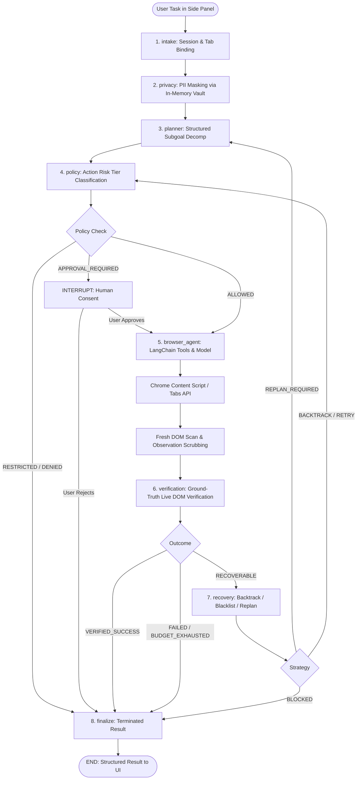

# PRATYAKSHA Architecture & System Design Specification
**System:** PRATYAKSHA (प्रत्यक्ष) — Sovereign LangChain + LangGraph Autonomous Browser Automation Agent  
**Environment:** Chrome Extension Manifest V3  
**Status:** COMPLETE & VERIFIED  
**Date:** October 12, 2026  

---

## 1. Architectural Overview

PRATYAKSHA is an on-device, sovereign, privacy-first browser automation agent operating inside a Chrome Extension under Manifest V3. 

The system transitions from an earlier procedural while-loop engine to a production-grade, stateful multi-node workflow powered by **LangChain** and **LangGraph**:
- **LangChain Core & Models:** Manages multi-provider ChatModel instantiation (Mistral AI, Google Gemini, OpenRouter), dynamic structured tool definitions with Zod schema validation, and fallback chains.
- **LangGraph Outer Workflow:** Orchestrates the autonomous agent lifecycle using a compiled `StateGraph` featuring deterministic conditional edges, ground-truth live evidence verification, bounded recovery/backtracking, human-in-the-loop interrupts, and persistent checkpointing.
- **Chrome MV3 Browser Engine:** Directs low-level DOM perception, accessibility tree indexing, and synthetic input simulation while safeguarding against navigation timeouts and message-channel disconnects.
- **Sovereign Privacy Shield:** Integrates client-side PII tokenization (Aadhaar via Verhoeff algorithm, Indian PAN, RFC 5322 emails, Indian mobile numbers) with ephemeral in-memory dictionaries, ensuring raw PII is never transmitted to cloud LLM providers.



---

## 2. Directory Layout & Module Responsibilities

```
PRATYAKSHA/
├── src/
│   ├── shared/
│   │   ├── constants.js          # Risk tiers, tool categories, canonical services, forbidden schemes
│   │   ├── errors.js             # Standardized domain error classes (recoverable vs fatal)
│   │   └── schemas.js            # Authoritative Zod schemas (19 tools), OpenAI & Gemini converters
│   │
│   ├── browser/
│   │   ├── browser-tools.js      # Hardened Chrome tabs/scripting dispatcher & navigation semantics
│   │   ├── page-context.js       # Fresh DOM scanner, bounded table builder & target blacklist
│   │   ├── dom-actions.js        # Synthetic cursor, React/Vue synthetic event overrides
│   │   └── content-main.js       # Content script message receiver and executor
│   │
│   ├── safety/
│   │   ├── privacy.js            # PII Vault integration, observation & event scrubbing
│   │   ├── action-policy.js      # Action classification (read-only to irreversible)
│   │   ├── approval.js           # Replay-protected approval token binding & fingerprinting
│   │   ├── url-policy.js         # Forbidden protocol checks (chrome://, about:, data:)
│   │   └── execution-limits.js   # Execution budget tracker (steps, tool calls, recovery attempts)
│   │
│   ├── persistence/
│   │   ├── checkpointer.js       # ChromeStorageSaver (LangGraph BaseCheckpointSaver for MV3)
│   │   └── thread-store.js       # Task thread isolation, status CRUD & tab resumability checks
│   │
│   ├── agent/
│   │   ├── models.js             # LangChain ChatModel factory (Mistral, Gemini, OpenRouter)
│   │   ├── browser-tools.js      # LangChain StructuredTool adapters bound to session tab
│   │   ├── state.js              # Authoritative LangGraph AgentState Annotation channels
│   │   ├── planner.js            # Structured plan schema, LLM planner node & offline fallback
│   │   ├── agent.js              # LangChain model/tool execution turn & system prompt builder
│   │   ├── verifier.js           # Live evidence verifier rejecting false completion claims
│   │   ├── recovery.js           # Bounded recovery node, loop detector & history backtracker
│   │   └── graph.js              # StateGraph assembly, conditional routing & compiled runner
│   │
│   ├── ui/
│   │   └── agent-events.js       # UI event streaming, lifecycle relays, secret redactions
│   │
│   └── runner.js                 # Unified entry point & backward-compatible LangGraphAgent facade
│
├── pratyaksha-extension/
│   ├── manifest.json             # Manifest V3 extension configuration
│   ├── background/
│   │   └── service-worker.js     # Background worker & dynamic script injector
│   ├── sidepanel/
│   │   ├── panel.html            # Primary Side Panel Cockpit HTML
│   │   ├── panel.js              # Side Panel Controller & UI Event Listener
│   │   ├── panel.css             # High-DPI dark glassmorphism styling
│   │   └── orb-3d.js             # WebGL / Canvas living 3D Orb controller
│   ├── content/
│   │   ├── dom-actions.js        # Webpage DOM interaction engine
│   │   ├── content-main.js       # Content script message router
│   │   └── highlighter.css       # Visual bounding box & glowing control border
│   ├── agent/
│   │   ├── graph-engine.js       # Bundled production ESM agent bundle (via esbuild)
│   │   └── browser-tools.js      # Compatibility dispatcher wrapper
│   └── vault/
│       └── pii-vault.js          # In-memory Verhoeff Aadhaar & PAN privacy shield
│
├── tests/                        # Comprehensive test suite (node --test)
│   ├── helpers/
│   │   └── mock-chrome.js        # Headless Chrome API test double
│   ├── schemas.test.js           # Tool schemas & converters (5 tests)
│   ├── browser-tools.test.js     # Browser execution layer (8 tests)
│   ├── models.test.js            # LangChain model factory (4 tests)
│   ├── agent-tools.test.js       # LangChain tool adapters (3 tests)
│   ├── safety.test.js            # Privacy, action & URL policies (5 tests)
│   ├── planner.test.js           # State channels & planner (5 tests)
│   ├── verifier-recovery.test.js # Ground-truth verifier & recovery (4 tests)
│   ├── graph.test.js             # StateGraph workflow execution (4 tests)
│   ├── persistence.test.js       # Checkpointer & thread store (3 tests)
│   └── runner.test.js            # Unified runner & UI events (3 tests)
│
├── docs/
│   ├── implementation-audit.md   # Architectural discovery & defect audit
│   ├── implementation-plan.md    # Chunks A-L implementation plan & risk mitigation
│   ├── architecture.md           # This comprehensive architecture document
│   └── agent-graph.mmd           # Exported Mermaid topology diagram of compiled StateGraph
│
├── build.js                      # esbuild bundling pipeline for Chrome MV3
└── package.json                  # Dependencies, test & build scripts
```

---

## 3. Tool System & Shared Contracts

PRATYAKSHA enforces **one single authoritative tool registry** (`src/shared/schemas.js`) defining 19 browser tools with typed Zod validation:

| # | Tool Name | Category | Default Risk | Purpose |
|---|---|---|---|---|
| 1 | `search_web` | Navigation | `READ_ONLY` | Searches web via Google, Bing, or DuckDuckGo and extracts results. |
| 2 | `open_url` | Navigation | `REVERSIBLE` | Navigates tab to exact destination URL with scheme normalization. |
| 3 | `go_back` | Navigation | `REVERSIBLE` | Navigates back in browser history (used for recovery/backtracking). |
| 4 | `go_forward` | Navigation | `REVERSIBLE` | Navigates forward in browser history. |
| 5 | `switch_tab` | Navigation | `REVERSIBLE` | Switches active browser tab by title or URL keyword match. |
| 6 | `read_page` | Reading | `READ_ONLY` | Extracts visible text content, optionally focused on a CSS selector. |
| 7 | `get_page_metadata` | Reading | `READ_ONLY` | Returns title, URL, meta description, and Open Graph tags. |
| 8 | `get_links` | Reading | `READ_ONLY` | Returns all hyperlinks on page filtered by keyword. |
| 9 | `find_on_page` | Reading | `READ_ONLY` | Searches for exact text match, scrolls to first match. |
| 10 | `extract_structured`| Reading | `READ_ONLY` | Extracts structured JSON fields using scoped CSS selectors. |
| 11 | `click_element` | Interaction | `REVERSIBLE` | Clicks button or link by numeric `[ID]` from the DOM table. |
| 12 | `type_into_element` | Interaction | `SENSITIVE` | Types text into input with local PII rehydration and Enter support. |
| 13 | `execute_js` | Interaction | `RESTRICTED` | Executes arbitrary JavaScript in page context (privileged). |
| 14 | `inspect_dom` | Observation | `READ_ONLY` | Retrieves accessibility info, attributes, and nearby DOM children. |
| 15 | `screenshot` | Observation | `READ_ONLY` | Captures visible viewport as PNG; keeps multimodal data intact. |
| 16 | `scroll_page` | Observation | `READ_ONLY` | Scrolls viewport up, down, top, or bottom by pixel delta. |
| 17 | `wait_for` | Waiting | `READ_ONLY` | Waits until element selector or text appears dynamically. |
| 18 | `wait_seconds` | Waiting | `READ_ONLY` | Pauses for 0.5–10s to let dynamic SPA transitions settle. |
| 19 | `finish_task` | Completion | `READ_ONLY` | Completion signal (does not bypass ground-truth verifier). |

### Standard Internal Tool Result Contract
Every tool returns an identical contract:
```typescript
interface ToolResult {
  ok: boolean;
  toolName: string;
  observation: string;
  page: {
    url: string;
    title: string;
    id: number | null;
  };
  metadata: Record<string, any>;
  newTabId: number | null;
  screenshotDataUrl: string | null;
  isFinished: boolean;
  success: boolean;
  summary: string | null;
  error: {
    message: string;
    code: string;
    recoverable: boolean;
    details: any;
  } | null;
  timestamp: number;
}
```

---

## 4. Safety, Action Policy & Privacy Framework

### 4.1 Action Risk Classification
The Action Policy node inspects the upcoming operation before it reaches execution:
- **`READ_ONLY`**: Observation tools (`read_page`, `screenshot`, `search_web`). Allowed immediately.
- **`REVERSIBLE`**: Standard navigation and innocuous clicks (`open_url`, `scroll_page`, clicking navigation links). Allowed immediately.
- **`SENSITIVE`**: Typing credentials or auth data (`password`, `pin`, `cvv`, `otp`). Generates approval token and interrupts execution.
- **`IRREVERSIBLE`**: Operations that alter real-world state (Send email clicks, payments, order submissions, account deletions). Pauses execution and triggers LangGraph `interrupt()`.
- **`RESTRICTED`**: `execute_js` or navigations to prohibited origins (`chrome://`, `about:`). Blocked or requires explicit human clearance.

### 4.2 Replay-Protected Human Approval
- Each approval request creates a cryptographically unique token (`appr_<timestamp>_<random>`).
- The token is bound to an exact action fingerprint: `hash(toolName, args, pageUrl)`.
- Resuming execution validates that:
  1. The thread ID matches.
  2. The action parameters have not been altered by the model.
  3. The browser is still on the same page.
  4. The approval token is consumed immediately upon execution to prevent replay attacks.

### 4.3 Privacy Shield
- **Pre-intake Anonymization:** Indian Aadhaar (validated with Verhoeff checksum algorithm), PAN cards, emails, and phone numbers are tokenized to `[AADHAAR_xxxx]`, `[PAN_xxxx]`, `[EMAIL_xxxx]`, and `[PHONE_xxxx]`.
- **Local Rehydration:** When `type_into_element` runs, values are rehydrated in-memory right at the content-script execution boundary. Cloud LLM providers only see pseudonymized tokens.
- **Observation Scrubbing:** Passwords in input values and raw API tokens (`sk-...`, `ghp_...`, `Bearer ...`) are masked before entering LLM message context.
- **Checkpoint Sanitization:** All API keys and auth tokens are stripped from state channels prior to persistent checkpoint serialization.

---

## 5. Ground-Truth Verification & Bounded Recovery

### 5.1 Verification Gate
Model-generated claims of task completion are strictly un-trusted. Success requires physical browser proof:
- **Email Workflow:** Must have navigated to `mail.google.com`, filled recipient and body fields, and triggered the Send button.
- **Search Query:** Must have dispatched the search and collected non-empty extracted observations.
- **Navigation:** Current tab URL must match the target destination.

### 5.2 Bounded Recovery & Backtracking
- **Loop Detection:** If the model attempts the exact same tool and arguments consecutively, the target element ID is blacklisted and the agent executes a pivot scroll.
- **Domain Drift:** If an action accidentally navigates away from the user's requested canonical service (e.g., clicking an external ad or navigation link), the agent executes `chrome.tabs.goBack()` to restore page stability.
- **Recovery Budget:** Maximum recovery attempts is capped at 3. If failures persist, the workflow terminates safely with status `BLOCKED` rather than burning infinite model tokens.

---

## 6. Manifest V3 Compatibility & Build Pipeline

In Chrome Extension Manifest V3, background service workers and side panel HTML files run native ES modules but cannot resolve bare npm package specifiers (`@langchain/*`).

### The Build Solution (`build.js`):
- `esbuild` bundles the complete modular architecture from `src/runner.js` into `pratyaksha-extension/agent/graph-engine.js`.
- Target: `chrome120`, format: `esm`, platform: `browser`.
- Output: A standalone, high-performance 5.2 MB ES module exporting `LangGraphAgent`, `PratyakshaAgentRunner`, `CANONICAL_SERVICES`, and `detectTargetService`.
- `pratyaksha-extension/sidepanel/panel.js` retains its existing import:
  ```javascript
  import { LangGraphAgent } from '../agent/graph-engine.js';
  ```
- 100% backward compatibility is preserved for the 3D Orb, stop button, chat streaming, and settings configuration!
