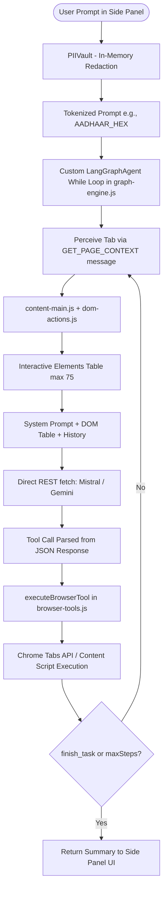

# PRATYAKSHA Codebase Discovery & Architectural Audit
**Generated:** October 12, 2026  
**Auditor:** Principal Software Architect & Implementation Engineer  
**System:** PRATYAKSHA (प्रत्यक्ष) — On-Device Visual Perception & Privacy Shield for Light-Weight Browser Agents

---

## 1. Executive Summary & Existing Architecture

PRATYAKSHA is designed as an on-device, privacy-preserving browser automation system implemented as a Chrome Extension (Manifest V3). 

### Current High-Level Architecture

### Key Components Inspected
1. **Manifest & Extension Boundary** (`pratyaksha-extension/manifest.json`):
   - Manifest V3 with `activeTab`, `scripting`, `storage`, `sidePanel`, `tabs` permissions, and `<all_urls>` host permissions.
   - Background service worker: `background/service-worker.js` (`type: "module"`).
   - Content scripts: `content/dom-actions.js`, `content/content-main.js`, and `content/highlighter.css`.
   - UI interfaces: `sidepanel/panel.html` (primary AI cockpit), `popup/popup.html` (quick launcher).
2. **Privacy Shield** (`pratyaksha-extension/vault/pii-vault.js`):
   - Client-side Verhoeff checksum algorithm for 12-digit Indian Aadhaar numbers.
   - Form 49A Regex validator for Indian PAN cards.
   - RFC 5322 regex for email addresses and Indian telecommunication numbering plan (+91 / 0) for mobile numbers.
   - Reversible in-memory token-to-value pseudonymization dictionary (`tokenToValueMap`).
3. **Browser Automation Engine** (`pratyaksha-extension/agent/browser-tools.js`):
   - Contains `BROWSER_TOOL_DECLARATIONS` (Gemini format).
   - Contains `MISTRAL_TOOL_DECLARATIONS` (converted OpenAI JSON Schema).
   - Contains `executeBrowserTool()` dispatcher (19 tool cases).
   - Tab management (`waitForTabLoad`, `ensureContentScript`, `switch_tab`, `sendToTab`).
4. **Current Orchestrator** (`pratyaksha-extension/agent/graph-engine.js`):
   - A single JavaScript class named `LangGraphAgent` that manually runs a `while` loop up to `maxSteps`.
   - Directly executes `fetch()` to `https://api.mistral.ai/v1/chat/completions` and `https://generativelanguage.googleapis.com/v1beta/models/...`.
   - Basic heuristic backtracking (triggering `chrome.tabs.goBack()` on 2 consecutive tool errors).
   - Primitive mechanical gate: checks for `mail.google.com` in action history if prompt mentions "email".
5. **Content Scripts & DOM Actions** (`pratyaksha-extension/content/`):
   - `dom-actions.js`: High-precision interactive element scanner (`scanInteractiveElements`), selector generators, synthetic mouse cursor (`moveAgentCursor`), click/type event dispatchers with React/Vue input event handling (`input`, `change`, `keydown`).
   - `content-main.js`: Chrome runtime message listener routing `GET_PAGE_CONTEXT`, `EXECUTE_ACTION`, `CLEAR_HIGHLIGHT`, `SET_CONTROL_ACTIVE`.
6. **Side Panel Controller & 3D UI** (`pratyaksha-extension/sidepanel/`):
   - `panel.js`: Connects DOM events, handles settings storage in `chrome.storage.local`, instantiates `LangGraphAgent`, and renders chat messages.
   - `orb-3d.js`: Three.js / Canvas 3D particle orb responding to agent states (`idle`, `reasoning`, `acting`, `error`).

---

## 2. Execution Flow Analysis

### Task Intake to Execution
1. User enters natural language objective in `panel.html` input box.
2. `handleRunPrompt()` in `panel.js` invokes `globalVault.anonymize(rawPrompt)`.
3. PII tokens replace real values (e.g. `9876543210` -> `[PHONE_4A1B]`).
4. `new LangGraphAgent(...)` is instantiated with provider configuration and `activeTab`.
5. The `run()` loop executes:
   - **Perceive:** Sends `GET_PAGE_CONTEXT` to active tab. `PratyakshaDOM.scanInteractiveElements()` gathers up to 75 visible buttons/inputs with assigned numeric IDs `[1]`, `[2]`, etc.
   - **Prompt Assembly:** Builds system prompt string embedding the ASCII element table.
   - **Reason:** Model call via raw HTTP `fetch()`. Model returns tool call or text.
   - **Pre-execution Loop Detection:** Checks if `toolName + args` matches `lastActionSig`. If repeated, logs loop and scrolls down.
   - **Mechanical Gate:** If `finish_task` is called on email tasks, checks if email was typed and Gmail was visited.
   - **Tool Dispatch:** Calls `executeBrowserTool()`. Sends action to content script via `chrome.tabs.sendMessage()`.
   - **Observation:** Formats result string and appends to internal `messages` array.
   - **Repeat:** Loops until `finish_task`, `cancel()`, or `maxSteps` (20) reached.

---

## 3. Reusable Modules & Strengths

| Module | Location | Reusable Assets | Quality / Retain Decision |
|---|---|---|---|
| **PIIVault** | `vault/pii-vault.js` | Verhoeff checksum algorithm, PAN validator, RFC 5322 regex, phone validator, ephemeral token store. | **100% Retain & Enhance**. Mature, solid algorithmic implementation. |
| **PratyakshaDOM** | `content/dom-actions.js` | `scanInteractiveElements`, element ID assignment, cursor animation, React/Vue `Object.getOwnPropertyDescriptor` value setter overrides. | **100% Retain**. Essential for browser interaction correctness across SPAs. |
| **Content Router** | `content/content-main.js` | Message routing, ping handling, CSS injector, frame control. | **100% Retain**. Working MV3 content message pump. |
| **Side Panel UI** | `sidepanel/` | 3D Orb canvas, settings modal, message bubbles, emergency 1-click stop. | **Retain UI Contract**. Adapt agent invocation to standard LangGraph stream events. |
| **Browser Tool Implementations** | `agent/browser-tools.js` | Underlying implementations for navigation, tab queries, DOM inspection, screenshot capture, wait utilities. | **Retain Logic, Refactor Contracts**. Extract into pure `browser/` core and wrap with LangChain tool adapters. |

---

## 4. Defects, Security Risks & Architectural Limitations Discovered

### A. Architectural Limitations
1. **Faux "LangGraph" Implementation:**
   - Despite being named `graph-engine.js`, the engine is a monolithic procedural JavaScript `while` loop.
   - There is no real LangGraph `StateGraph`, no compiled graph, no conditional edges, no node separation, no LangGraph checkpoints, and no interrupt/resume mechanism.
2. **Missing LangChain Abstraction:**
   - Raw HTTP `fetch()` calls are made to Mistral and Gemini endpoints.
   - No standardized `ChatModel` interface, no LangChain tool calling abstraction, and no provider fallback chains.
3. **No True Persistent Checkpointing:**
   - In-memory `checkpoints` array in `LangGraphAgent` only records `{ step, url, title }`.
   - If the Chrome Service Worker or Side Panel suspends or reloads, state is completely lost.
4. **No Resumable Human Approval:**
   - Currently, no human-in-the-loop interrupt exists. Destructive or sensitive actions (payments, deletions, email sends) proceed without approval or fail the rudimentary regex gate.

### B. Tool Registry & Schema Defects
1. **Tool Count Discrepancy:**
   - Comment in `browser-tools.js` header claims: *"Full autonomous tool suite — 15 browser tools"*.
   - Prompt mentions 18 tools.
   - Actual code in `BROWSER_TOOL_DECLARATIONS` contains **19 tools** (`search_web`, `open_url`, `go_back`, `go_forward`, `switch_tab`, `read_page`, `get_page_metadata`, `get_links`, `find_on_page`, `extract_structured`, `click_element`, `type_into_element`, `execute_js`, `inspect_dom`, `screenshot`, `scroll_page`, `wait_for`, `wait_seconds`, `finish_task`).
2. **Schema Conversion Incompleteness in `toOpenAiProp`:**
   - `toOpenAiProp` converts Gemini schemas to OpenAI JSON schema for Mistral. However, it does not handle nested array schemas (e.g. `items` with nested objects/properties), nullable fields, or complex type mappings cleanly.
3. **Inconsistent Tool Result Contract:**
   - Tools return varied shapes: `{ observation: string }`, `{ observation, newTabId }`, `{ observation, screenshotDataUrl }`, or `{ observation, isFinished, success, summary }`.
   - Errors throw arbitrary strings or return `ERROR: ...` without structured error classifications.

### C. Browser Execution & Safety Flaws
1. **False Navigation Assumptions on Channel Close:**
   - In `click_element`, catching `ChannelClosedError` assumes that channel closure always indicates successful page navigation. If the content script crashed or was restricted, it is falsely reported as navigation success.
2. **Unrestricted `execute_js` Execution:**
   - `execute_js` executes arbitrary code in the page context via `eval`/content script without origin safety checks or user approval.
3. **Weak Verification Gate:**
   - The gate only checks if `mail.google.com` is in the URL and `type_into_element` was called. It does not verify non-email tasks, does not verify actual DOM evidence, and can easily be hallucinated past.
4. **Stale DOM Snapshots:**
   - Interactive element IDs `[1]`, `[2]` are re-generated on every scan. When navigation or dynamic AJAX changes occur, old IDs become invalid, leading to mis-clicks without verification.

---

## 5. Dependency & Framework Compatibility Audit

| Dependency | Required Version | Status in Environment | Bundler / MV3 Compatibility |
|---|---|---|---|
| `@langchain/core` | `^1.2.17` | Verified available | Compatible via browser bundle (no Node built-in dependency). |
| `@langchain/langgraph` | `^1.4.21` | Verified available | Compatible via browser bundle. StateGraph and checkpointer operate in browser. |
| `@langchain/langgraph-checkpoint`| `^1.1.6` | Verified available | Base checkpointer interface. |
| `@langchain/mistralai` | `^1.2.0` | Verified available | Compatible; uses standard fetch in web environment. |
| `@langchain/google-genai` | `^2.3.2` | Verified available | Compatible with web environment. |
| `@langchain/openai` | `^1.6.2` | Verified available | Compatible; supports OpenRouter via `baseURL`. |
| `zod` | `^3.25.76` | Installed (`3.25.76`) | Native ESM, browser compatible. |
| `esbuild` | `^0.28.2` | Verified available | Ultra-fast bundler for Chrome MV3 extension builds. |
| `node:test` | Built-in (Node 26) | Installed (`v26.3.0`) | Built-in test runner, zero extra runtime dependencies. |

### Chrome Manifest V3 Bundling Strategy
- In Chrome MV3, extension pages and service workers cannot load bare npm specifiers (`import from '@langchain/langgraph'`) directly without bundling.
- We will establish an `esbuild` build pipeline that compiles the modular `src/` codebase into optimized browser-ready ESM bundles within `pratyaksha-extension/agent/`, preserving seamless integration with existing HTML files while enabling modular Node.js testing.

---

## 6. Required Migrations

1. **Schema Standardization:**
   - Unify all 19 browser tools under a single authoritative registry with Zod validation and bidirectional converter (LangChain tool format & JSON Schema).
2. **Browser Execution Layer Hardening:**
   - Refactor `browser-tools.js` into clean, testable units with standard result contracts (`{ ok, toolName, observation, page, metadata }`).
   - Distinguish real navigation success from channel closures and navigation timeouts.
3. **Model Factory:**
   - Implement `makeModel({ provider, model, apiKey })` supporting Mistral, Google Gemini, and OpenRouter with deterministic fallbacks.
4. **LangChain Tool Adapters:**
   - Wrap authoritative browser tools using LangChain's `tool()` with Zod input validation and privacy rehydration.
5. **StateGraph Implementation:**
   - Implement LangGraph `StateGraph` containing: `intake` -> `privacy` -> `planner` -> `policy` (with interrupt for human approval) -> `browser_agent` -> `verification` -> `recovery` -> `finalize`.
6. **Checkpointer & Persistent Thread Store:**
   - Implement a custom `ChromeStorageSaver` extending `BaseCheckpointSaver` utilizing `chrome.storage.local` to survive service worker deactivations and browser restarts.
7. **Action Policy & Human Approval:**
   - Policy node classifying actions into `read_only`, `reversible`, `sensitive`, `irreversible`, and `restricted`.
   - Interrupt graph execution when `approval_required` is triggered. Allow resumption from checkpoint upon user consent.
8. **Test Suite:**
   - Unit tests, schema tests, policy tests, and graph integration tests using `node:test`.

---

## 7. Baseline Test Status
- Existing test files: **0** (No tests existed prior to this audit).
- Target test baseline: Full suite covering schemas, converters, model factory, action policy, URL policy, privacy vault, verifier, recovery, graph routing, and checkpoint serialization.
