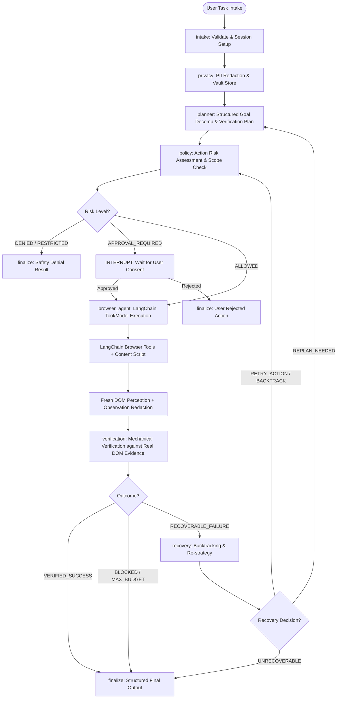
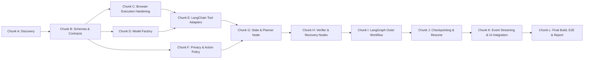

# PRATYAKSHA Implementation Plan & Migration Roadmap
**Target System:** Sovereign LangChain + LangGraph Browser Automation Agent  
**Standard:** Antigravity Master Implementation Protocol  
**Date:** October 12, 2026  

---

## 1. Target Architecture & Execution Graph



---

## 2. Directory Layout & Module Responsibilities

```
src/
├── shared/
│   ├── constants.js          # Canonical services, risk tiers, tool registries
│   ├── errors.js             # Standardized domain error classes
│   └── schemas.js            # Authoritative Zod schemas & JSON Schema converters
│
├── browser/
│   ├── browser-tools.js      # Core Chrome API & content-script dispatcher
│   ├── page-context.js       # Fresh DOM scanner & snapshot manager
│   ├── dom-actions.js        # Synthetic cursor, React/Vue event dispatchers
│   └── content-main.js       # Extension content script message router
│
├── safety/
│   ├── privacy.js            # PII Vault integration & token pseudonymization
│   ├── action-policy.js      # Action classification (read-only to irreversible)
│   ├── approval.js           # Approval state binding & interrupt validator
│   ├── url-policy.js         # Navigation safety, forbidden schemes & domains
│   └── execution-limits.js   # Budget tracking (model calls, tools, duration)
│
├── persistence/
│   ├── checkpointer.js       # ChromeStorageSaver (LangGraph BaseCheckpointSaver)
│   └── thread-store.js       # Session threads, resume validator, tab binding
│
├── agent/
│   ├── models.js             # Model factory (Mistral, Gemini, OpenRouter) + fallbacks
│   ├── browser-tools.js      # LangChain tool adapters with Zod schemas
│   ├── state.js              # Authoritative LangGraph State definition
│   ├── planner.js            # Structured plan generation node
│   ├── verifier.js           # Live evidence verification node
│   ├── recovery.js           # Self-correction, loop detection & backtracking node
│   ├── middleware.js         # Context pruning, tool validation, retry filters
│   ├── agent.js              # LangChain agent executor node
│   └── graph.js              # LangGraph StateGraph assembly & compiled runner
│
├── ui/
│   └── agent-events.js       # UI event streaming, lifecycle relays, redactions
│
└── runner.js                 # Unified entry point connecting UI to LangGraph

pratyaksha-extension/
├── agent/
│   └── graph-engine.js       # Backward-compatible facade exposing LangGraphAgent
├── background/
│   └── service-worker.js     # Manifest V3 service worker & script injector
└── sidepanel/
    └── panel.js              # Side Panel UI connecting user input to runner
```

---

## 3. Current File to Target File Mapping

| Current File | Target Location | Migration Strategy | Compatibility Guard |
|---|---|---|---|
| `pratyaksha-extension/agent/browser-tools.js` | `src/browser/browser-tools.js` & `src/shared/schemas.js` | Extract authoritative definitions and pure dispatcher. Derive LangChain tools. | Retain backwards-compatible export from `pratyaksha-extension/agent/browser-tools.js`. |
| `pratyaksha-extension/vault/pii-vault.js` | `src/safety/privacy.js` & `src/vault/pii-vault.js` | Preserve Verhoeff/PAN logic. Integrate observation and event scrubbing. | Expose singleton `globalVault`. |
| `pratyaksha-extension/agent/graph-engine.js` | Replaced by `src/agent/graph.js` + `src/runner.js` | Replace procedural while-loop with compiled LangGraph `StateGraph`. | Export compatible `LangGraphAgent` class wrapper in `pratyaksha-extension/agent/graph-engine.js`. |
| `pratyaksha-extension/agent/planner.js` | `src/agent/planner.js` | Migrate from prompt regexes to structured LLM planning node + fallback. | Support deterministic fallback when offline. |
| `pratyaksha-extension/content/dom-actions.js` | `src/browser/dom-actions.js` & `pratyaksha-extension/content/` | Retain DOM actions, cursor simulation, and synthetic events. | Content script stays referenced in `manifest.json`. |
| `pratyaksha-extension/content/content-main.js` | `src/browser/content-main.js` & `pratyaksha-extension/content/` | Retain message receiver and dispatcher. | Content script stays referenced in `manifest.json`. |
| `pratyaksha-extension/sidepanel/panel.js` | `pratyaksha-extension/sidepanel/panel.js` | Connect `handleRunPrompt` to LangGraph runner and stream events. | UI retains 100% of event listeners, 3D Orb, stop button. |

---

## 4. Implementation Chunks & Dependencies



### Chunk Breakdown & Acceptance Criteria

#### Chunk A: Discovery (Current)
- **Objective:** Complete repository and dependency audit.
- **Deliverables:** `docs/implementation-audit.md`, `docs/implementation-plan.md`.
- **Acceptance Criteria:** Baseline established, no uncommitted changes overwritten, clear roadmap.

#### Chunk B: Shared Contracts & Tool Schemas
- **Objective:** Create authoritative single-source-of-truth tool registry with Zod schemas and bidirectional format conversions.
- **Files:** `src/shared/constants.js`, `src/shared/errors.js`, `src/shared/schemas.js`, `tests/schemas.test.js`.
- **Acceptance Criteria:** All 19 tools validated with Zod, OpenAI/Gemini conversions tested, standard tool result contract enforced.

#### Chunk C: Browser Execution Hardening
- **Objective:** Harden Chrome browser execution, tab tracking, navigation timeouts, and safe retries.
- **Files:** `src/browser/browser-tools.js`, `src/browser/page-context.js`, `tests/browser-tools.test.js`.
- **Acceptance Criteria:** Real navigation distinguished from channel closures, stale tab tracking prevented, safe observation retries separated from side-effect retries.

#### Chunk D: LangChain Model Factory
- **Objective:** Implement unified LangChain model factory supporting Mistral, Google Gemini, and OpenRouter with deterministic fallbacks.
- **Files:** `src/agent/models.js`, `tests/models.test.js`.
- **Acceptance Criteria:** Valid ChatModel instances returned, tool calling verified, bad credentials fail fast, no secret leaks in logs.

#### Chunk E: LangChain Browser Tool Adapters
- **Objective:** Wrap authoritative browser operations with LangChain `DynamicStructuredTool` instances.
- **Files:** `src/agent/browser-tools.js`, `tests/agent-tools.test.js`.
- **Acceptance Criteria:** Tools validate input args with Zod, rehydrate PII locally, invoke dispatcher, return standard observations.

#### Chunk F: Privacy Layer & Action Policy
- **Objective:** Implement executable action policy, URL permissions, and prompt injection defense.
- **Files:** `src/safety/privacy.js`, `src/safety/action-policy.js`, `src/safety/url-policy.js`, `src/safety/approval.js`, `src/safety/execution-limits.js`, `tests/safety.test.js`.
- **Acceptance Criteria:** Sensitive actions classified (`read_only`, `reversible`, `sensitive`, `irreversible`, `restricted`), approval tokens generated, forbidden URLs blocked.

#### Chunk G: Shared Graph State & Planner Node
- **Objective:** Define LangGraph State schema and structured planner node.
- **Files:** `src/agent/state.js`, `src/agent/planner.js`, `tests/planner.test.js`.
- **Acceptance Criteria:** State channels defined cleanly with reducers, structured plan generated with subgoals and criteria, deterministic offline fallback preserved.

#### Chunk H: Verification & Recovery Nodes
- **Objective:** Build mechanical verifier evaluating live DOM state and bounded recovery node for backtracking.
- **Files:** `src/agent/verifier.js`, `src/agent/recovery.js`, `tests/verifier-recovery.test.js`.
- **Acceptance Criteria:** Ground-truth evidence required for success, loop detection triggers self-correction, maximum recovery budget strictly enforced.

#### Chunk I: LangGraph Outer Workflow
- **Objective:** Assemble full LangGraph `StateGraph` with conditional routing and subgraphs.
- **Files:** `src/agent/agent.js`, `src/agent/graph.js`, `docs/agent-graph.mmd`, `tests/graph.test.js`.
- **Acceptance Criteria:** Graph compiles, edges route based on explicit state, human approval interrupts execution, graph visualization generated.

#### Chunk J: Persistent Checkpointing & Resume
- **Objective:** Implement `ChromeStorageSaver` extending `BaseCheckpointSaver` for MV3 persistence.
- **Files:** `src/persistence/checkpointer.js`, `src/persistence/thread-store.js`, `tests/persistence.test.js`.
- **Acceptance Criteria:** Graph state survives service worker termination, resume re-validates tab and approved action, no secrets stored in plain text.

#### Chunk K: Event Streaming & UI Integration
- **Objective:** Bridge LangGraph lifecycle events to sidepanel UI and 3D Orb.
- **Files:** `src/ui/agent-events.js`, `src/runner.js`, `pratyaksha-extension/sidepanel/panel.js`.
- **Acceptance Criteria:** UI receives progress events, approval modal triggers, 1-click stop cleanly aborts execution.

#### Chunk L: Final Build, Validation & Documentation
- **Objective:** Bundle extension using `esbuild`, validate MV3 compliance, run full test suite, produce architecture document and final report.
- **Files:** `docs/architecture.md`, `package.json` build scripts, final test run.
- **Acceptance Criteria:** All test suites pass, extension builds cleanly into `pratyaksha-extension/`, final implementation report generated.

---

## 5. Risks and Mitigations

| Risk | Impact | Mitigation |
|---|---|---|
| **MV3 Bare Specifiers:** Chrome extensions cannot import `@langchain/*` natively. | High | Use `esbuild` to compile `src/runner.js` into an optimized browser ESM bundle (`pratyaksha-extension/agent/graph-engine.js` / bundle) with zero runtime Node dependencies. |
| **Model Hallucination of Task Completion:** Model claiming email sent without clicking Send. | High | Verifier node inspects actual DOM snapshot and action history. Disallows `finish_task` without verifiable evidence. |
| **Irreversible Operations Executing Silently:** Sending funds or deleting resources. | High | Action Policy categorizes destructive operations and triggers LangGraph `interrupt()` to require explicit user confirmation. |
| **PII Leakage in LLM Prompts or Events:** Leaking Indian Aadhaar or PAN. | High | Pre-intake tokenization via `PIIVault`, local rehydration only at execution boundary, redaction on all event streams. |
| **Service Worker Inactivity Termination:** Chrome MV3 terminates background workers after 30s. | Medium | State persisted via `ChromeStorageSaver` checkpointer in `chrome.storage.local`. Interrupted runs resume seamlessly. |
