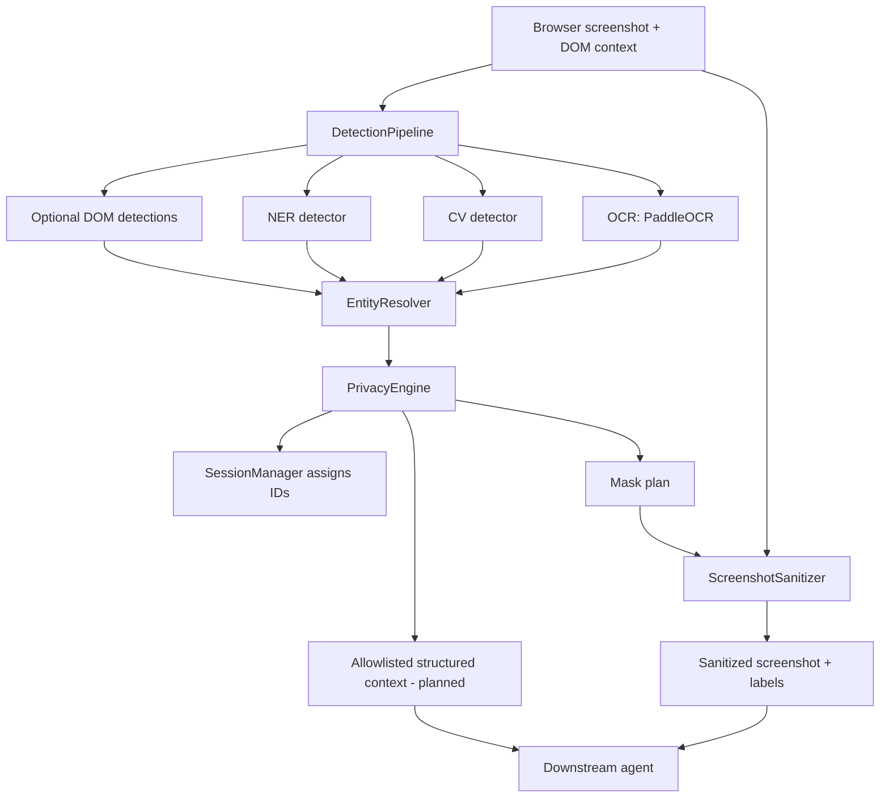
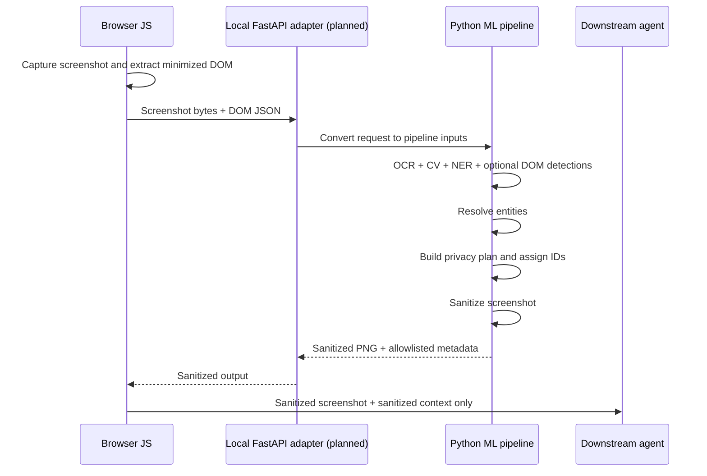

# Pratyaksha --- Privacy-Preserving Browser Context Pipeline

> **Project:** SIH 2026 · ISRO Problem Statement 26171\
> **Workstream:** Screenshot/DOM understanding and privacy sanitization\
> **Status:** Python prototype modules are integrated locally;
> screenshot sanitizer unit test passes. Browser/WebGL integration and
> production privacy validation are planned work.

## Overview

Pratyaksha is intended to let a browser-side agent understand a page
while limiting exposure of sensitive information. The browser supplies a
screenshot and DOM-derived context. The ML pipeline performs OCR,
computer vision (CV), and named-entity recognition (NER), resolves
detections, builds a privacy mask plan, and generates a sanitized
screenshot annotated with session-local entity IDs.

The intended downstream handoff contains a sanitized screenshot plus an
explicitly allowlisted structured payload. Raw screenshot content, raw
detected text, resolver evidence, unredacted DOM values, and private
entity-ID mappings must not be sent to the downstream agent.

**Prototype caveat:** this is not yet a guarantee of complete privacy.
Detection coverage, coordinate alignment, DOM redaction, release gating,
and browser integration still require validation.

## Architecture



## Implemented modules

### 1. Detection pipeline --- `ML/src/pipeline.py`

Coordinates detector instances:

-   `OCRDetector`: extracts text from screenshots.
-   `CVDetector`: detects visual objects/regions.
-   `NERDetector`: recognizes named entities in text.
-   Optional DOM detections supplied by the caller.

Current API:

``` python
from ML.src.pipeline import DetectionPipeline
from ML.src.workers.ocr import OCRDetector
from ML.src.workers.cv import CVDetector
from ML.src.workers.ner import NERDetector

pipeline = DetectionPipeline(
    ocr_detector=OCRDetector(),
    cv_detector=CVDetector(),
    ner_detector=NERDetector(),
    strict=True,
)

result = pipeline.run(
    image_path,
    dom_text=None,
    dom_detections=None,
)
```

The result includes `detections`, `by_source` (`ocr`, `cv`, `ner`,
`dom`), `ocr_text`, `stage_errors`, and `ready_for_privacy_processing`.
OCR detections have context IDs, and NER detections can reference the
OCR fragment from which they were derived. NER spans are character
offsets in that fragment; an OCR parent box is approximate, not
necessarily an exact entity-level box.

### 2. Entity resolver --- `ML/src/privacy/entity_resolver.py`

Consolidates detections into entity records and relationship
information. Output includes `entities`, `relationships`,
`unresolved_detections`, `detection_count`, and `entity_count`.

Entity records can contain `entity_id`, `type`, `text`, `sources`,
`bounding_boxes`, `text_spans`, `context_ids`, `confidence_scores`,
`detection_ids`, `evidence`, `requires_review`, `parent_regions`, and
`effective_bounding_boxes`.

**Security note:** `text` and `evidence` can contain sensitive raw
content. Never pass resolver output directly to a remote agent or log it
in production. Build downstream data with a strict allowlist. Spatial
relationships remain limited until coordinate-space metadata is
consistent and validated.

### 3. Session manager --- `ML/src/privacy/session_manager.py`

Creates session-local IDs such as `ENTITY_0001`, `ENTITY_0002`, etc.
Keep one manager for a browser session, rather than creating one per
screenshot. Reuse an ID only when an upstream component reliably
establishes that detections across screenshots refer to the same entity.
A per-run resolver ID should not automatically be treated as a stable
cross-screenshot identity. Keep the private mapping local.

### 4. Privacy engine --- `ML/src/privacy/privacy_engine.py`

Consumes resolver output and builds a mask plan. It canonicalizes
entity-type aliases, decides which entities to mask, assigns privacy
IDs, and records mask regions and review status.

Plan fields include `session_id`, `mask_regions`, `decisions`,
`unlocalized_entities`, `requires_human_review`,
`ready_for_sanitization`, `ready_for_release`, and `metadata`.

The current policy conservatively masks configured sensitive types and
uncertain/review-required entities. Entities without usable boxes are
marked unlocalized and block readiness in the tested case.

**Known limitation:** the current readiness flags do not prove that
boxes are in original screenshot pixel coordinates, that all regions are
valid, or that all sensitive content was detected. They must not alone
authorize transmission.

### 5. Screenshot sanitizer --- `ML/src/privacy/screenshot_sanitizer.py`

Uses Pillow to open the original image, read `mask_regions`, validate
basic bounding-box structure, clip coordinates, replace each requested
region with an opaque rectangle, draw a label such as `[ENTITY_0001]`,
save a PNG, and return metadata rather than detected text.

``` python
from ML.src.privacy.screenshot_sanitizer import ScreenshotSanitizer

sanitizer = ScreenshotSanitizer()
summary = sanitizer.sanitize(
    image_path="input.png",
    privacy_plan=plan,
    output_path="outputs/sanitized_screenshot.png",
)

print(summary["sanitization_completed"])
print(summary["mask_count"])
```

**Assumption to verify:** boxes are `[x1, y1, x2, y2]` in original
screenshot pixel coordinates. Verify this against OCR/CV workers before
releasing real output. If a requested mask region is malformed,
sanitization aborts without saving output. Overlapping labels and label
placement still need improvement.

## Relevant repository layout

``` text
Pratyaksha/
└── ML/
    ├── src/
    │   ├── pipeline.py
    │   ├── workers/
    │   │   ├── ocr.py
    │   │   ├── cv.py
    │   │   └── ner.py
    │   └── privacy/
    │       ├── __init__.py
    │       ├── entity_resolver.py
    │       ├── session_manager.py
    │       ├── privacy_engine.py
    │       └── screenshot_sanitizer.py
    └── tests/
        ├── test_entity_resolver.py
        ├── test_privacy_engine.py
        ├── test_privacy_integration.py
        └── test_screenshot_sanitizer.py
```

This is the relevant logical layout; filenames may change during
integration.

## Setup

Use the project's existing Python 3.11 environment and install
dependencies required by the detector implementations. Pillow is
required by the screenshot sanitizer:

``` powershell
python -m pip install Pillow
```

Install PaddleOCR/PaddlePaddle, model weights, and other ML dependencies
using the versions already selected by the project. Avoid blindly
upgrading packages in the working environment.

The current Windows development setup has used:

``` powershell
$env:USE_TF = "0"
```

Run module commands from the repository root so imports such as
`ML.src.pipeline` resolve.

## Running tests

### Entity resolver

``` powershell
$env:USE_TF = "0"
python -m ML.tests.test_entity_resolver
```

Exercises the detector pipeline and resolver. Counts depend on the input
screenshot and model versions.

### Privacy engine

``` powershell
$env:USE_TF = "0"
python -m ML.tests.test_privacy_engine
```

The synthetic test passed with 3 entities, 2 mask regions, and 1
unlocalized entity; the unlocalized entity caused readiness to be false.

### End-to-end Python integration

``` powershell
$env:USE_TF = "0"
python -m ML.tests.test_privacy_integration
```

A previous local run reported:

``` text
Pipeline detections: 14
Resolved entities: 14
Unresolved detections: 6
Mask regions: 14
Unlocalized entities: 0
Requires human review: True
Ready for sanitization: True
Ready for release: True
Privacy integration test completed.
```

These counts are specific to that test input, not guarantees. The
readiness flags need stronger coordinate-space, coverage, and
fail-closed validation.

### Screenshot sanitizer

``` powershell
$env:USE_TF = "0"
python -m ML.tests.test_screenshot_sanitizer
```

Previously passed:

``` text
Screenshot sanitizer test passed.
Mask count: 1
Output dimensions: 300x160
Original image unchanged: True
```

This synthetic test validates basic masking and preservation of the
input, not coordinate alignment or complete privacy coverage.

## Input contract: screenshot + DOM

### Screenshot

The browser layer should capture the relevant visible page/viewport and
send the image to the local processing layer. Include screenshot
dimensions and capture/coordinate metadata. The exact browser capture
mechanism depends on whether this is a browser extension or a regular
web app; a normal web page cannot freely capture privileged browser UI
or arbitrary tabs.

### DOM

Extract a minimized, structured DOM representation in browser JavaScript
and serialize it as JSON. Prefer relevant visible elements over the full
DOM. Example **proposed schema**:

``` json
{
  "url_origin": "https://example.invalid",
  "viewport": {
    "width": 1280,
    "height": 800,
    "device_pixel_ratio": 1
  },
  "elements": [
    {
      "node_id": "node_17",
      "tag": "input",
      "role": "textbox",
      "label": "Email",
      "visible": true,
      "bbox": [120, 220, 420, 260],
      "coordinate_space": "viewport_css_pixels"
    }
  ]
}
```

Omit raw input values unless needed for local processing. Do not send
cookies, authentication tokens, hidden form values, full page source, or
unrelated personal data. If local detection requires a value, keep it
local and redact it before any remote handoff.

The current `DetectionPipeline.run()` accepts `image_path` plus optional
`dom_text` and `dom_detections`. A browser-to-Python adapter must
convert the selected DOM JSON schema to those inputs; that adapter is
not implemented yet.

### Proposed HTTP request

A future local endpoint could accept multipart form data:

``` text
POST /sanitize
Content-Type: multipart/form-data

screenshot: <PNG or JPEG bytes>
dom_context: <JSON string>
request_id: <opaque request ID>
```

This is a **proposed contract**, not an implemented endpoint. FastAPI
adapter and browser transport code remain future work.

### Coordinate spaces

Screenshot boxes generally use image pixels; DOM boxes often use CSS
viewport pixels. Do not compare or draw them interchangeably without a
verified conversion that accounts for screenshot size, viewport size,
device pixel ratio, scroll position, resizing, and cropping. Every box
must have a defined and validated coordinate space.

## Proposed browser / WebGL integration

The current Python modules do not execute inside WebGL. The recommended
first integration is browser JavaScript communicating with a local
Python service, such as FastAPI, which hosts the existing models and
modules.



WebGL can render overlays or masks in the browser, but it does not
directly run Python. Two approaches are possible:

1.  **Initial prototype --- local Python service:** browser sends
    screenshot and DOM JSON to a loopback FastAPI service. Existing
    Python models, resolver, privacy engine, and Pillow sanitizer run
    locally. Only sanitized output is forwarded remotely.
2.  **Later browser-native version:** convert compatible models to ONNX
    and use ONNX Runtime Web with WebAssembly or a supported GPU
    backend; implement privacy logic in JavaScript/TypeScript and
    render/export the masked image in the browser. This requires model
    conversion and extensive validation.

If the requirement means sensitive inputs must never leave the browser
process, clarify whether a local loopback service is acceptable before
choosing the architecture.

## Expected outputs

The complete system is intended to produce three outputs.

### 1. Sanitized screenshot

A PNG with sensitive regions replaced by opaque masks and labels such as
`[ENTITY_0001]`. The original screenshot remains unchanged.

Illustrative sanitizer summary:

``` json
{
  "output_path": "outputs/sanitized_screenshot.png",
  "image_width": 1280,
  "image_height": 800,
  "mask_count": 14,
  "masked_entity_ids": ["ENTITY_0001", "ENTITY_0002"],
  "rejected_region_count": 0,
  "sanitization_completed": true
}
```

Values are examples; real counts depend on the request. This is local
diagnostic metadata, not necessarily the remote API response.

### 2. Sanitized structured context

A proposed allowlisted payload for the downstream agent:

``` json
{
  "request_id": "req_example",
  "screenshot": {
    "media_type": "image/png",
    "width": 1280,
    "height": 800
  },
  "entities": [
    {
      "entity_id": "ENTITY_0001",
      "type": "EMAIL",
      "sources": ["ocr", "ner"],
      "masked": true
    }
  ],
  "dom": {
    "elements": [
      {
        "node_id": "node_17",
        "tag": "input",
        "role": "textbox",
        "label": "Email",
        "value": "[ENTITY_0001]",
        "visible": true,
        "bbox": [120, 220, 420, 260]
      }
    ]
  },
  "privacy": {
    "requires_human_review": false
  }
}
```

This is a target schema only; the current modules do not yet emit it.
Include only reviewed and allowlisted fields. Exclude raw entity text,
resolver `evidence`, unredacted OCR text, original DOM values, and
private ID mappings. Entity IDs are pseudonymous references, not proof
that all remaining data is anonymous.

### 3. Local diagnostic summary

Local diagnostics can include detection/entity/mask counts, unresolved
count, and review status. Do not log screenshots, raw OCR text, DOM
values, or resolver evidence.

## Privacy and failure handling

Before enabling remote release:

-   Validate every box's format, bounds, and coordinate space.
-   Verify OCR/CV boxes align with the original screenshot pixels.
-   Convert DOM coordinates only with validated viewport/capture
    metadata.
-   Block release or require review for unresolved detections, invalid
    boxes, detector failures, or sanitization failures.
-   Validate coverage; valid boxes do not prove every sensitive item was
    detected.
-   Keep original screenshots, raw OCR text, DOM values, resolver
    evidence, and private ID mappings local.
-   Forward only sanitized images and allowlisted context to the
    downstream agent.
-   Never forward the original screenshot as a fallback when
    sanitization fails.
-   Test overlaps, tiny/out-of-bounds boxes, high-DPI captures,
    scrolling, resizing, and label collisions.
-   Keep IDs stable only within the intended browser-session boundary.
-   Avoid retaining sensitive inputs and outputs longer than necessary.

## Current status

### Implemented / tested locally

-   OCR/CV/NER detection pipeline with optional DOM inputs.
-   Context IDs connecting NER spans to OCR text fragments.
-   Entity resolver with unresolved-detection reporting.
-   Session-local entity ID manager.
-   Privacy engine that creates mask plans and review flags.
-   Pillow screenshot sanitizer that applies opaque masks and labels.
-   Synthetic privacy-engine and screenshot-sanitizer tests passed.
-   Pipeline → resolver → privacy-engine integration test ran
    successfully on a local sample.

### Planned / incomplete

-   FastAPI request/response endpoint.
-   Browser screenshot capture and DOM serialization/transport.
-   Exact DOM JSON schema and adapter to `dom_text` / `dom_detections`.
-   Verified coordinate-space conventions across OCR, CV, DOM, and
    screenshot.
-   Strict allowlisted structured-context builder.
-   Post-sanitization coverage checks and robust release gating.
-   Browser/WebGL end-to-end integration.
-   RAM, latency, and concurrency benchmarks.
-   Production privacy/security review.

## Suggested next steps

1.  Standardize screenshot and DOM coordinate metadata.
2.  Implement fail-closed release checks and output validation.
3.  Build the allowlisted structured-context sanitizer.
4.  Add a local FastAPI adapter around the existing Python modules.
5.  Integrate browser capture, DOM serialization, and sanitized output
    display.
6.  Test with synthetic fixtures before controlled local screenshots.
7.  Measure RAM and latency; evaluate browser-native ONNX/WebAssembly
    only if required.

## Development notes

-   Run module commands from the repository root.
-   Prefer synthetic test fixtures.
-   Do not commit real identity screenshots, sensitive DOM dumps,
    credentials, or unredacted outputs.
-   This README distinguishes the current prototype from proposed
    architecture and APIs; planned features are not described as already
    implemented.
