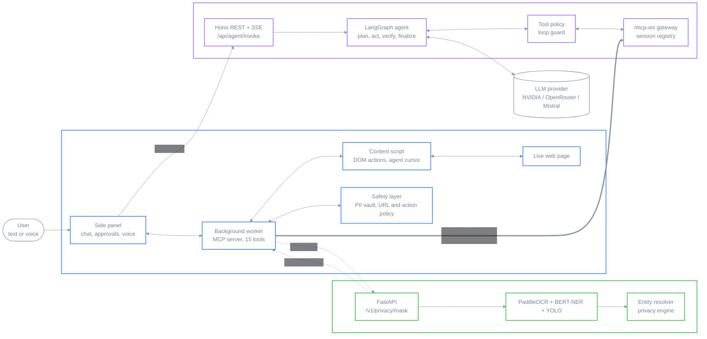
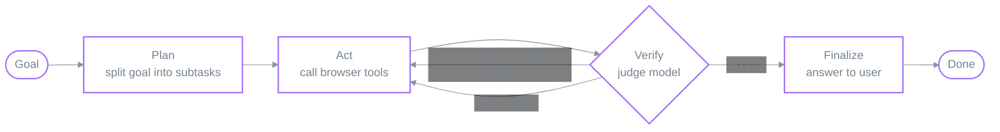
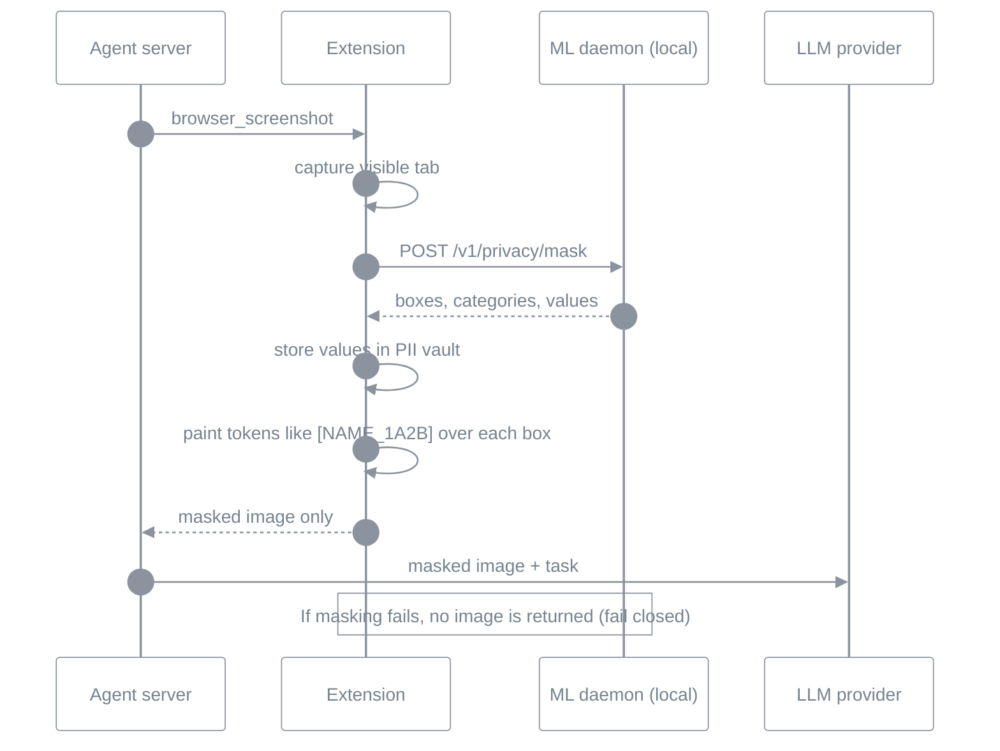

<div align="center">


# Pratyaksha

**Privacy-first browser agent that runs in your real Chrome.**

Your Chrome becomes a Model Context Protocol (MCP) server. A LangGraph agent plans and acts on live pages, while personal data is masked on your own machine before any model sees it.

[](LICENSE)


[Live site](https://ps-26171.vercel.app) · [Architecture](#architecture) · [Quick start](#quick-start) · [Browser tools](#browser-tools) · [Security model](#security-model)

</div>

---

## Table of contents

- [Why Pratyaksha](#why-pratyaksha)
- [Features](#features)
- [Architecture](#architecture)
- [How a run works](#how-a-run-works)
- [Browser tools](#browser-tools)
- [Security model](#security-model)
- [Repository layout](#repository-layout)
- [Quick start](#quick-start)
- [Configuration](#configuration)
- [API reference](#api-reference)
- [Testing](#testing)
- [Documentation](#documentation)
- [Contributing](#contributing)
- [License](#license)

---

## Why Pratyaksha

Most browser agents run a headless browser in the cloud. That has three problems:

| Problem | What goes wrong |
|---|---|
| **Data exposure** | Raw screenshots and page text, with names, emails, card numbers and IDs, are sent to third-party models. |
| **No real sessions** | A cloud browser has none of your logins, intranet access or saved state. |
| **Token cost** | Full DOM dumps and large images per step are slow and expensive. |

Pratyaksha flips this. **Your real browser is the tool server. The cloud is only the brain.**

- The extension exposes the open browser as an MCP server over a framed WebSocket.
- Page text and screenshots are cleaned locally. The model sees tokens like `[EMAIL_7F3A]`, never the raw value.
- The browser puts the real value back only on the original site, and risky actions wait for your approval.

---

## Features

| Area | What you get |
|---|---|
| **Reverse MCP** | The Chrome extension hosts an MCP server with 15 browser tools. The backend connects to it as a client. |
| **Agent loop** | LangGraph state machine: `plan → act → verify → finalize`, with a separate judge model checking each subtask. |
| **Local PII masking** | Regex plus checksum validation (Luhn for cards, Verhoeff for Aadhaar) on text, and an on-device ML daemon for screenshots. |
| **Screenshot privacy** | PaddleOCR + BERT-NER + YOLO find private spots. The screenshot fails closed if masking is not possible. |
| **Human approval** | Payments, deletes, submits and other risky actions pause for an approval prompt in the side panel. |
| **Loop guard** | Stops repeated calls, repeated failures and two-step cycles before they burn tokens. |
| **Multi-provider LLMs** | NVIDIA, OpenRouter or Mistral. The first provider with a key wins. |
| **Voice input** | Speak a task in the side panel using the Web Speech API. |
| **Secure transport** | Google sign-in, short-lived HS256 JWTs, single-use WebSocket tickets and an extension-origin check. |

---

## Architecture

Pratyaksha is a pnpm monorepo with three running parts and two shared libraries.



| Part | Path | Runtime | Role |
|---|---|---|---|
| Extension | [`apps/extension`](apps/extension) | Chrome MV3, WXT | MCP server, DOM actions, side panel, PII vault, approvals |
| Agent server | [`apps/server`](apps/server) | Node.js 22, Hono, LangGraph | Auth, run management, agent loop, MCP client |
| ML daemon | [`ML`](ML) | Python 3.12, FastAPI | Finds private text and regions in screenshots |
| Contracts | [`packages/contracts`](packages/contracts) | TypeScript, Zod | Shared tool schemas, agent events, wire types |
| Transport | [`packages/mcp-ws`](packages/mcp-ws) | TypeScript | Length-prefixed WebSocket framing, liveness |

**Why split it this way**

- **Isolation.** Async I/O and LLM calls live in Node. Heavy vision models live in Python. Live DOM access lives in the browser.
- **Small blast radius.** If the server restarts, your tabs and logins are untouched. If the ML daemon is down, screenshots fail closed and the agent keeps working with text.
- **Your sessions stay yours.** Nothing about your logins leaves the browser.

---

## How a run works

### Agent loop



### Screenshot masking



### Step by step

1. You type or speak a goal in the side panel.
2. The extension gets a single-use ticket from `POST /api/ws-ticket` and opens `/mcp-ws`.
3. The side panel calls `POST /api/agent/invoke`. Progress streams back over SSE.
4. The planner breaks the goal into subtasks.
5. The actor calls browser tools. Page text is masked before it leaves the browser.
6. Risky actions pause for your approval. Vault tokens are swapped back to real values only on the original site.
7. The judge model checks each subtask and asks for a retry when needed.
8. The final answer streams back to the side panel.

---

## Browser tools

All 15 tools are defined once in [`packages/contracts/src/tools.ts`](packages/contracts/src/tools.ts) and shared by both sides.

| Tool | What it does | Safety boundary |
|---|---|---|
| `browser_navigate` | Open a URL, or go back, forward, reload | Blocks `chrome:`, `file:`, `data:`, `javascript:` and the Web Store |
| `browser_snapshot` | Accessibility text tree of the page | PII masked before it leaves the browser |
| `browser_find` | Find elements by intent | Read only |
| `browser_click` | Click an element by ref | Risky clicks need approval |
| `browser_type` | Type into an input | Vault tokens restored only on the source origin |
| `browser_fill_form` | Fill many fields at once | Sensitive forms need approval |
| `browser_select` | Pick an option in a `<select>` | Checks the option exists |
| `browser_press_key` | Send a key like Enter or Tab | Bound to the focused element |
| `browser_scroll` | Scroll the page or a container | Viewport bound |
| `browser_wait_for` | Wait for text, its removal, or a URL | Bounded timeout |
| `browser_extract` | Pull a table, list or article | Read only |
| `browser_screenshot` | Screenshot with PII replaced by tokens | Fails closed without the ML daemon |
| `browser_code_editor` | Read or write code in Monaco, CodeMirror or Ace | Uses the editor's own API and format action |
| `browser_tabs` | List, switch, open or close tabs | Closing a tab you opened needs approval |
| `browser_ping` | Measure round-trip latency | Read only |

Set `AGENT_VISION=false` to hide `browser_screenshot` for a model that cannot read images.

---

## Security model

| Layer | Control | Where |
|---|---|---|
| Identity | Google sign-in, verified server side, then an HS256 JWT | [`apps/server/src/auth`](apps/server/src/auth) |
| Socket | Single-use ticket, `Origin` must match the fixed extension ID | [`apps/server/src/auth/tickets.ts`](apps/server/src/auth/tickets.ts), [`apps/server/src/ws/mcp-ws.ts`](apps/server/src/ws/mcp-ws.ts) |
| Text privacy | Emails, phones, cards (Luhn), Aadhaar (Verhoeff) become vault tokens | [`apps/extension/safety/privacy.ts`](apps/extension/safety/privacy.ts) |
| Vault | Real values stay in the browser and are bound to their origin | [`apps/extension/safety/pii-vault.ts`](apps/extension/safety/pii-vault.ts) |
| Image privacy | OCR + NER + YOLO masking, fail closed | [`ML/src/privacy`](ML/src/privacy) |
| URL policy | Blocks browser-internal schemes and store pages | [`apps/extension/safety/url-policy.ts`](apps/extension/safety/url-policy.ts) |
| Action policy | Payments, deletes, submits and sends need approval | [`apps/extension/safety/action-policy.ts`](apps/extension/safety/action-policy.ts) |
| Personal guard | Stops the model from making up personal values | [`apps/server/src/agent/personal-guard.ts`](apps/server/src/agent/personal-guard.ts) |
| Loop guard | 3 repeats, 2 failures, or a 2-step cycle in 6 calls stops the run | [`apps/server/src/agent/loop-guard.ts`](apps/server/src/agent/loop-guard.ts) |
| Prompt injection | Page content is treated as untrusted data | [`apps/server/src/agent/prompts.ts`](apps/server/src/agent/prompts.ts) |

Found a vulnerability? See [SECURITY.md](SECURITY.md).

---

## Repository layout

```text
Pratyaksha/
├── apps/
│   ├── extension/          Chrome MV3 extension (WXT)
│   │   ├── entrypoints/
│   │   │   ├── background/ MCP server, tool executor, auth, connection
│   │   │   ├── content/    DOM actions and agent cursor
│   │   │   ├── sidepanel/  Chat UI, approvals, voice input
│   │   │   └── mic-permission/
│   │   ├── safety/         PII vault, privacy, URL and action policy
│   │   └── e2e/            Playwright end-to-end tests
│   └── server/             Hono + LangGraph agent server
│       ├── src/
│       │   ├── agent/      Planner, actor, judge, guards, prompts
│       │   ├── auth/       Google verify, JWT, WebSocket tickets
│       │   ├── mcp/        Device session registry
│       │   ├── routes/     REST and SSE routes
│       │   └── ws/         /mcp-ws upgrade handler
│       ├── fixtures/       Local HTML pages for tests
│       └── test/
├── packages/
│   ├── contracts/          Shared Zod schemas and wire types
│   └── mcp-ws/             Framed WebSocket transport
├── ML/                     Python privacy daemon (FastAPI)
│   ├── src/workers/        OCR, NER, CV, regex detectors
│   ├── src/privacy/        Entity resolver, privacy engine, sanitizer
│   └── tests/
├── tests/                  Cross-package test suites
└── Docs/                   Design notes and plans
```

---

## Quick start

### Prerequisites

| Tool | Version |
|---|---|
| Node.js | 22 or newer |
| pnpm | 12 (via `corepack enable`) |
| Python | 3.12 or newer |
| [uv](https://docs.astral.sh/uv/) | latest |
| Chrome | 116 or newer |

### 1. Install

```bash
git clone https://github.com/Sahil-coder-30/Pratyaksha.git
cd Pratyaksha
corepack enable
pnpm install
```

### 2. Configure

```bash
cp apps/server/.env.example apps/server/.env
cp apps/extension/.env.example apps/extension/.env
```

Fill in at least one LLM key and the auth values. See [Configuration](#configuration).

### 3. Run

Open three terminals at the repository root.

```bash
pnpm dev:server   # agent server on http://127.0.0.1:8787
```

```bash
pnpm dev:ml       # ML privacy daemon on http://127.0.0.1:8788
```

```bash
pnpm dev:ext      # opens Chrome with the extension loaded
```

### 4. Check health

```bash
curl http://127.0.0.1:8787/healthz
# {"ok":true,"name":"bigfish","devices":0,"runs":0}
```

```bash
curl http://127.0.0.1:8788/ready
# {"status":"ready","models_loaded":["paddleocr","yolov8","bert_base_ner"]}
```

The ML daemon downloads model weights on first start, so `/ready` may return `503` for a while.

---

## Configuration

### Server (`apps/server/.env`)

| Variable | Required | Description |
|---|---|---|
| `PORT`, `HOST` | no | Bind address. Default `127.0.0.1:8787`. |
| `NVIDIA_API_KEY` | one LLM key | NVIDIA key from build.nvidia.com. Tried first. |
| `NVIDIA_MODEL`, `NVIDIA_JUDGE_MODEL` | no | Actor and judge models for NVIDIA. |
| `OPEN_ROUTER_API_KEY` | one LLM key | OpenRouter key. Tried second. |
| `OPEN_ROUTER_MODEL`, `OPEN_ROUTER_JUDGE_MODEL` | no | Actor and judge models for OpenRouter. |
| `MISTRAL_API_KEY` | one LLM key | Mistral key. Tried third. |
| `AGENT_MODEL`, `AGENT_JUDGE_MODEL` | no | Actor and judge models for Mistral. |
| `AGENT_VISION` | no | `false` hides `browser_screenshot`. |
| `GOOGLE_EXTENSION_CLIENT_ID` | yes | Google OAuth client of type "Chrome Extension". |
| `JWT_SECRET` | yes | At least 32 random characters. |
| `EXTENSION_ID` | yes | Fixed extension ID. `/mcp-ws` accepts only this origin. |
| `ENABLE_DEV_ROUTES` | no | `1` enables dev-only routes. Never in production. |

### Extension (`apps/extension/.env`)

| Variable | Description |
|---|---|
| `WXT_SERVER_URL` | Agent server base URL. Default `http://127.0.0.1:8787`. |
| `WXT_ML_URL` | ML daemon URL. Default `http://127.0.0.1:8788`. |
| `WXT_EXTENSION_KEY` | Public key (base64, no PEM header) that fixes the extension ID. Never the private key. |
| `WXT_GOOGLE_CLIENT_ID` | Google OAuth client ID for the fixed extension ID. |

### ML daemon

| Variable | Default |
|---|---|
| `BIGFISH_ML_HOST` | `127.0.0.1` |
| `BIGFISH_ML_PORT` | `8788` |

---

## API reference

### Agent server

| Method | Path | Auth | Purpose |
|---|---|---|---|
| `GET` | `/healthz`, `/ready` | none | Liveness and readiness |
| `POST` | `/api/auth/google` | Google token | Exchange a Google token for a JWT |
| `POST` | `/api/ws-ticket` | JWT | Single-use ticket for `/mcp-ws` |
| `GET` | `/mcp-ws` | ticket + origin | Extension WebSocket (MCP) |
| `GET` | `/api/devices` | JWT | List your connected browsers |
| `POST` | `/api/devices/:deviceId/ping` | JWT | Round-trip latency to a browser |
| `POST` | `/api/agent/invoke` | JWT | Start a run, streams events over SSE |
| `POST` | `/api/agent/cancel` | JWT | Stop a running run |

### ML daemon

| Method | Path | Purpose |
|---|---|---|
| `GET` | `/healthz`, `/ready` | Liveness and model readiness |
| `POST` | `/v1/privacy/mask` | Find private regions in a screenshot |
| `POST` | `/v1/privacy/sanitize` | Return a sanitized image |

---

## Testing

```bash
pnpm --filter @bigfish/server test        # agent, loop guard, MCP socket
```

```bash
pnpm --filter @bigfish/extension test     # safety layer unit tests
```

```bash
pnpm --filter @bigfish/server exec tsx --test ../../tests/*.test.mjs   # cross-package suites
```

```bash
uv --project ML run pytest ML/tests       # ML privacy daemon
```

```bash
pnpm typecheck                            # all TypeScript packages
```

Playwright end-to-end tests live in [`apps/extension/e2e`](apps/extension/e2e).

---

## Documentation

| Doc | Topic |
|---|---|
| [apps/server/README.md](apps/server/README.md) | Agent server internals |
| [apps/extension/README.md](apps/extension/README.md) | Extension internals |
| [ML/README.md](ML/README.md) | ML privacy daemon |
| [packages/contracts/README.md](packages/contracts/README.md) | Shared contracts |
| [packages/mcp-ws/README.md](packages/mcp-ws/README.md) | WebSocket transport |
| [Docs/Browser-Tools.md](Docs/Browser-Tools.md) | Tool design notes |
| [Docs/MCP-Plan.md](Docs/MCP-Plan.md) | MCP architecture plan |

---

## Contributing

Contributions are welcome. Read [CONTRIBUTING.md](CONTRIBUTING.md) before opening a pull request.

## License

Released under the [MIT License](LICENSE).

<div align="center">
<sub><b>Pratyaksha</b> (Sanskrit: "directly perceived"). Your browser, your data, your agent.</sub>
</div>
