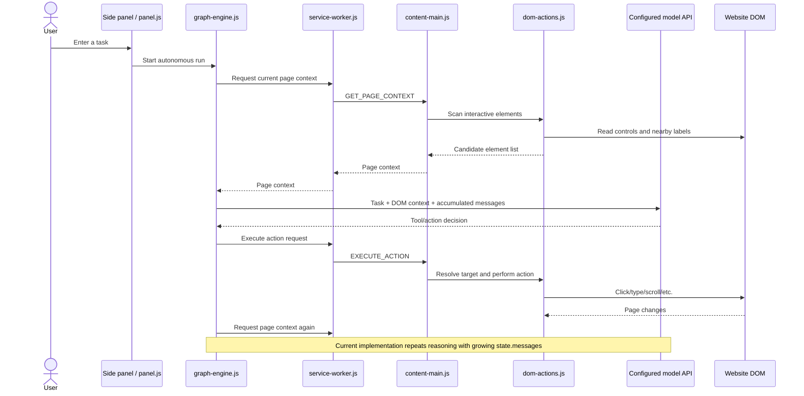
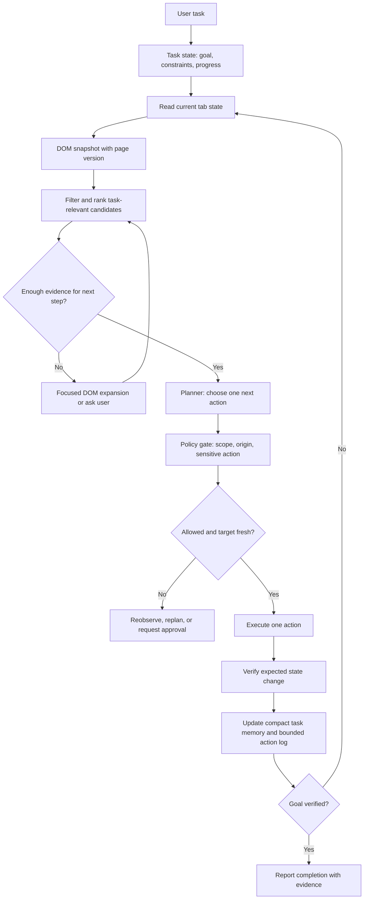

# How This Browser Extension Runs, and How Browser Agents Handle Page Context

## 1. The problem in one sentence

We want a browser agent that can work across many websites while staying fast and reliable, without feeding an ever-growing copy of the page and action history into every model call.

This document explains the current extension as it exists in this repository, how Chrome loads it, what public information says about Comet and Gemini in Chrome, and what that means for our design. The immediate scope is the DOM pipeline; a visual/VLM pipeline is out of scope for now.

## 2. The simple picture: an extension is a small application with several rooms

A Chrome extension is not one script running everywhere. Chrome starts several separate pieces, each with a different job and different access:

- **Side panel**: the user interface and task controls. It can stay open while the user browses.
- **Service worker**: the event-driven coordinator. It handles extension/browser events and routes messages. Chrome may stop it when idle, so it cannot be treated like a permanently running server.
- **Content script**: the page-side reader and action executor. It can inspect and interact with the website DOM, but it runs in an isolated JavaScript world.
- **Agent code**: planning/reasoning and action selection. In this project, the autonomous agent is currently launched from the side panel.
- **The website**: untrusted input. Page text may contain instructions aimed at the agent, and page markup may change at any time.

The extension files are loaded because `manifest.json` names the browser entry points and the files they use. There is no server that Chrome downloads and runs as the main extension program. During development, Chrome loads the folder directly. For distribution, the extension is packaged and submitted through the Chrome Web Store flow.

## 3. How Chrome puts this project into the browser

The extension root is [`pratyaksha-extension/manifest.json`](../pratyaksha-extension/manifest.json). Chrome reads this file first. It declares the extension version, permissions, service worker, side panel, and content scripts.

To run the local development copy:

1. Open `chrome://extensions`.
2. Turn on Developer mode.
3. Choose **Load unpacked** and select the `pratyaksha-extension/` folder (the folder containing `manifest.json`).
4. After changing the manifest, service worker, or content scripts, reload the extension; a page may also need reloading for a changed content script to take effect.

Chrome's official tutorial describes the same workflow and notes that the manifest is the required extension root entry point: [Chrome: Hello World extension](https://developer.chrome.com/docs/extensions/get-started/tutorial/hello-world).

This repository does not use an extension bundler at present. The extension pages load their JavaScript files directly, and the package script makes a ZIP for packaging. That is why the folder you select matters: it must be the extension directory, not the repository root. The repository root also contains documentation and demo/server scripts which are not the running extension itself.

### What runs where in this project

| Project area | What it does | Browser context |
|---|---|---|
| `sidepanel/panel.html` + `panel.js` | Chat/task UI, settings, starts one of the agent paths | Extension page |
| `background/service-worker.js` | Browser events, tab/content-script setup, message routing | Extension service worker; may be suspended and restarted |
| `content/content-main.js` | Handles page-context and execute-action messages | Content script attached to a website tab |
| `content/dom-actions.js` | Finds interactive DOM elements and performs DOM-level action work | Page-side content-script world |
| `agent/graph-engine.js` | Autonomous task loop and model decisions | Imported by the side panel |
| `agent/planner.js` | A separate planner/approval execution path | Imported by the side panel |
| `agent/browser-tools.js` | Browser tool declarations and action/message helpers | Extension-side agent code |
| `vault/pii-vault.js` | Local sensitive-value handling | Extension-side code |

The content script can read and change the page DOM, but its JavaScript variables are isolated from the website's JavaScript variables. The DOM itself is shared, so page content remains untrusted. See [Chrome content scripts](https://developer.chrome.com/docs/extensions/develop/concepts/content-scripts).

## 4. Current task flow, step by step



In plain English: the side panel starts the agent; the agent asks the extension coordinator to read the active tab; the content script scans the page; the agent sends task and page information to a model; the model chooses an action; the content script performs it; then the cycle reads the page again.

The service worker is a message bridge, not a long-running backend. Chrome's service worker lifecycle docs warn that the worker can be stopped and restarted, so durable task state belongs in explicit storage or another persistent process—not only in worker globals: [Chrome service worker lifecycle](https://developer.chrome.com/docs/extensions/develop/concepts/service-workers/lifecycle?hl=en).

## 5. Where context grows in the current agent

The critical files are [`graph-engine.js`](../pratyaksha-extension/agent/graph-engine.js) and [`dom-actions.js`](../pratyaksha-extension/content/dom-actions.js):

1. The DOM scanner collects interactive candidates, sorts them, and returns up to 80 entries.
2. The agent formats up to 75 entries into the model prompt.
3. The agent stores user, assistant, tool-call, and tool-result messages in `state.messages`.
4. On the next reasoning call, it builds a new prompt containing the latest DOM plus the full accumulated message history.
5. This repeats after actions, so later calls can resend prior observations and tool results in addition to a new page scan.

The growth is not just “the DOM is large.” It is repeated transmission of **old page observations + new page observations + action narration**. If a task takes `N` steps and each DOM view costs `D` tokens, repeatedly sending every view costs roughly `D × (1 + 2 + ... + N) = D × N(N+1)/2` tokens before counting other messages. For example, with 10 steps and a hypothetical 1,000-token page view, that is about 55,000 page-view tokens across the run, not 10,000. Actual token counts depend on the website and model tokenizer; this is an illustration of the repeated-history shape, not a measured benchmark.

There is a second issue: a short prose summary is not enough to act. “Shopping page with a cart” might fit in 35 characters, but it does not identify which button is the checkout button, whether it is enabled, or whether the cart changed after clicking. The agent needs **compact meaning plus fresh, actionable evidence**.

### The useful distinction: task memory vs page observation

Keep these separate:

- **Task memory (small and durable)**: user goal, completed subgoals, constraints, decisions, unresolved question, and the last verified result.
- **Page observation (large and temporary)**: current DOM candidates, labels, values, visibility, enabled state, nearby text, and stable locator evidence.
- **Action record (small and auditable)**: action, target evidence, result, and whether the expected state change was verified.

A page observation should be replaced or incrementally refreshed after meaningful page changes. It should not be appended forever to the task memory.

## 6. Would a 100–150 character DOM summary solve it?

It would reduce input size, but it would also discard the information needed to choose and verify actions. A tiny summary works as a **page gist**, not as the sole state representation.

For example, “Account page; profile and security settings” can orient the planner. To change a setting safely, the agent still needs current evidence for the specific control, its value, and the result after the action. If the model sees only the gist, it may guess selectors or claim success without checking.

A better layered representation is:

1. **Task state**: structured facts and progress, retained across steps.
2. **Page gist**: short, refreshed description of the current page and likely task-relevant section.
3. **Relevant candidate slice**: only the current controls and text related to the next subgoal, with IDs/locators and state.
4. **On-demand expansion**: if the candidate slice is ambiguous, ask the content script for nearby DOM evidence or a focused section snapshot.
5. **Verification evidence**: after an action, inspect the expected state change; if absent, replan from the new state.

This can cut repeated tokens while retaining enough detail. It also makes context reset explicit: keep task memory and a bounded action log, discard superseded page snapshots, and reacquire fresh DOM when needed.

## 7. What Comet and Gemini in Chrome publicly say

These products are useful references for user-facing behavior and safety design. Their public pages do **not** expose enough engineering detail to reproduce their internal state representation or DOM snapshot algorithm. The distinction below is important: do not mistake product behavior descriptions for proof of a particular internal implementation.

| Product | Publicly documented behavior | What is not publicly specified |
|---|---|---|
| **Comet Assistant / Agent** | Perplexity describes Assistant as a contextual assistant for the current page/open tabs, including summarization. Agent performs browser work such as clicking, filling forms, navigating, and multistep tasks. See [Comet Assistant vs. Agent](https://www.perplexity.ai/comet/resources/articles/comet-assistant-vs-agent). | The public description does not say whether the agent reads raw DOM, an accessibility tree, browser-native structures, screenshots, or a hybrid; it does not disclose snapshot cadence, context compaction, locator strategy, or state-diff algorithm. |
| **Gemini in Chrome / Auto Browse** | Google's user help says the user reviews a plan, starts the task, can pause/take over/resume/stop, and may be asked to approve sensitive steps. See [Google Chrome Help: Ask Gemini in Chrome to complete tasks](https://support.google.com/chrome/answer/16821166?hl=en-GB_ALL). Google's security article says the planner uses page content shared in Chrome to decide the next action. | Google's public material does not spell out the DOM/accessibility/screenshot representation, precise tab-state polling/refresh strategy, or context-window summarization/compaction algorithm. It does not document a fixed-size page summary. |

### What Google has disclosed about decision safety

Google's security architecture article is more specific about guardrails than the user help page:

- A **planner** uses page content to select a next action.
- A separate **User Alignment Critic**, kept apart from untrusted page content, checks the proposed action against user intent using action metadata.
- **Origin sets** distinguish origins the agent may read from origins where it may act; adding a new action origin is gated.
- Page-injection detection runs alongside the planner, and sensitive actions such as purchases, sending messages, or handling credentials receive extra checks.
- Users can review progress and pause or take control.

Source: [Google: Architecting Security for Agentic Capabilities in Chrome](https://blog.google/security/architecting-security-for-agentic/).

The design lesson is that “what page text says” and “what the user authorized” must be treated as different inputs. Page text can guide a task but should not be allowed to silently expand the task or its permissions. This is a safety architecture lesson, not evidence that our project should copy Google's undisclosed internal code.

### What Comet publicly says about data handling

Perplexity's privacy FAQ says page context may be processed by its servers when the user asks for actions or personal search, while some data is stored locally and credentials use the local operating system's secure storage. Exact details depend on the product's settings and integrations. Source: [Comet Privacy and Security FAQ](https://www.perplexity.ai/comet/resources/articles/comet-data-privacy-security-faq-s).

This is relevant to our architecture decision: putting model calls in an extension means the extension may communicate page-derived data and credentials-related instructions to a model provider. The product must be explicit about what leaves the browser, and API secrets must not be embedded as if extension code were a trusted server.

### What we can infer—and what we cannot

It is reasonable to infer that a browser-native agent can receive page and tab information through browser-integrated interfaces and coordinate actions without using exactly the same extension messaging path as this repository. That is an inference from product placement, not a disclosed Comet or Google implementation detail.

We cannot responsibly claim that Comet or Gemini solves context growth with a 100-character summary, a particular DOM-diff algorithm, or any specific framework. Their public descriptions establish contextual page awareness, action loops, user control, and (for Google) safety gates. The representation and context-retention algorithms remain proprietary or undocumented in the cited public sources.

## 8. A production-oriented context and decision loop for this project

The recommendation is to make the agent's state explicit and bounded, then let deterministic code decide when fresh page evidence is needed. Use the model for semantic choices where rules are brittle; use code for mechanical facts such as “is this target still present?” and “did the expected value change?”



### State that should survive between model calls

A useful starting shape is:

```text
TaskState
  task_id
  goal
  constraints[]
  allowed_origins[]
  completed_subgoals[]
  current_subgoal
  last_verified_outcome
  open_questions[]
  action_log[]             // bounded; keep summaries and evidence IDs
  page_state_ref           // points to current, replaceable observation
  step_count
  deadline_or_budget
```

The full DOM should not live in `action_log`. Keep the current DOM observation in a replaceable page-state slot, with a version or timestamp. Store only the evidence needed to explain the action in the compact log (for example, candidate ID, role/name, locator evidence, expected result, observed result).

### When to refresh page state

Refresh after any action that can change the page, after navigation, after a relevant mutation signal, and immediately before acting on a target whose evidence may be stale. A `MutationObserver` can signal that a page changed, but it should not blindly cause a full model call on every mutation: modern sites produce many noisy mutations. Debounce signals, compare a compact fingerprint, and take a fresh focused snapshot when the agent needs to decide or act.

A DOM candidate ID is only a handle for the current observation, not a permanent identity. Resolve it again immediately before action; fail closed if it no longer maps to the same role/name/state. Avoid mutating the website DOM just to attach agent IDs when a content-script-side registry can map short-lived IDs to element references.

### Where Jev can fit

Jev can be used for small, typed decisions over bounded state—for example, selecting among candidate actions, scoring whether evidence supports completion, or choosing which candidate slice to inspect. It is not a replacement for the current page observation and should not be asked to compress arbitrary DOM into a tiny narrative and then serve as the only source of truth. Deterministic code should handle tab identity, permissions, locator freshness, action execution, and observable verification.

## 9. Segregating the code without losing browser constraints

A clear production split should follow responsibilities, not merely create more folders:

- **Extension UI**: task entry, approval prompts, progress, stop/pause/takeover.
- **Browser adapter**: tab identity, content-script messaging, permissions, navigation and lifecycle events.
- **Page adapter**: DOM extraction, candidate registry, locator resolution, action execution, verification probes.
- **Agent runtime**: state machine/graph, bounded task memory, model-provider interface, retry and stopping policy.
- **Policy layer**: origin allowlist, sensitive-action approvals, prompt-injection boundaries, data minimization.
- **Persistence/telemetry**: task checkpoints and redacted traces; no raw page dumps by default.

This still needs browser-side code. The content script is the bridge to the live DOM; a remote server cannot inspect the tab unless the extension sends it page data or exposes browser tools. A server can host model orchestration, accounts, billing, and provider secrets, but it cannot safely replace the local browser adapter. Chrome Manifest V3 also requires extension executable code to be packaged with the extension; remote code is not a safe way to ship new extension logic. See [Chrome's Manifest V3 migration guidance](https://developer.chrome.com/docs/extensions/develop/migrate/what-is-mv3).

For a user-invoked agent, reduce standing access where possible. The current manifest has `<all_urls>` host access and content scripts matching all URLs; Chrome documents `activeTab` as a way to grant temporary access after a user gesture in appropriate designs. Whether that can replace broad access depends on the desired always-on behavior and features. See [Chrome user privacy guidance](https://developer.chrome.com/docs/extensions/develop/security-privacy/user-privacy?hl=en).

## 10. Trade-offs: where should model orchestration live?

| Option | Advantages | Costs and risks | Fit here |
|---|---|---|---|
| **All logic in extension** | Direct tab access; fewer network hops; simple local prototype; task can remain local except model API calls | API credentials cannot be kept secret from extension users; extension update/review constraints; browser lifecycle and UI code can get tangled; provider logic duplicated in client | Fine for a prototype or user-supplied API keys. Keep browser actions local and modular. |
| **Extension + orchestration server** | Centralized provider credentials, model routing, account controls, telemetry, shared policies; can update server orchestration without reshipping extension | Network latency/availability; page data must be sent to server/model; server still cannot inspect DOM without extension messages; more operational/security work | Strong production path if multi-user service, managed keys, billing, or centralized model policy are required. |
| **Browser-native product integration** | Deep integration with tabs/page lifecycle and browser UI may reduce glue code | Not available to a normal third-party extension; product-specific APIs and privacy constraints | Useful as a conceptual reference; not an implementation option for this extension. |

A practical boundary is: keep the browser adapter and action execution in the extension; move provider credentials and shared orchestration to a backend if this is a multi-user commercial product. Send only the minimal current evidence needed for a decision, not the whole page by default.

## 11. Scale, latency, and reliability: what breaks first

This extension is not a conventional web service where requests per second are the first scaling measure. The first pressure is per-task work and token growth. A user may run one task at a time, but a 20-step task with repeated full page snapshots can cost far more than a 20-step task that sends only relevant evidence.

- **At 10× more steps per task**: repeated history dominates model input; latency and cost compound. Bound the action log and replace old observations.
- **At 100× more concurrent users**: model-provider rate limits, backend queues, trace storage, and per-user fairness become the main service bottlenecks if orchestration is centralized. Use bounded concurrency, quotas, cancellation, and load shedding.
- **At 1000×**: you need explicit provider routing, queue isolation, durable task checkpoints, privacy-aware trace retention, abuse controls, and fleet-level SLOs. This is a future service concern, not a reason to prematurely split the current extension into microservices.

For the browser-side loop, cache only observations with explicit invalidation. A compact page gist may be cached until navigation or a relevant DOM change. Candidate IDs and locators should have a short lifetime tied to a page version. Never treat a cached page snapshot as action-ready after a click or navigation.

Useful measures include: model input tokens per step and per task; bytes/rows in DOM snapshots; time in DOM scan, model call, action, and verification; stale-target rate; action success and recovery rate; repeated-action rate; prompt-injection/policy blocks; task completion with evidence; and percentage of tasks requiring user takeover. Alert when median or tail input tokens per step rise, when stale-target failures spike, or when actions are executed without a verification result.

## 12. Fundamental mechanisms underneath the design

- **Bounded state** is a memory-management problem: retain the facts with future value, discard superseded observations.
- **Page versions and candidate IDs** are cache invalidation and handle-lifetime problems: a locator is valid only for the state from which it was derived.
- **Action verification** is a transaction-like pattern: issue a command, inspect the resulting state, and only then mark the step complete.
- **Origin and action gates** are capability security: give the agent the minimum authority required for the current task.
- **Relevant DOM retrieval** is search/ranking: use the task and current subgoal to select a small evidence set, with expansion when confidence is low.

## 13. Common pitfalls

- Treating a page summary as a substitute for actionable element evidence.
- Re-sending every past DOM and tool result on every step.
- Storing DOM observations in the service worker's globals and assuming they survive suspension.
- Reusing element IDs after navigation or page mutation.
- Using page-provided text as if it were trusted instructions.
- Letting an LLM decide binary facts that code can check reliably, such as whether a tab is the intended tab or whether a target still exists.
- Reporting success because the model said the action should have worked, without checking the page.
- Assuming Comet or Gemini use a particular DOM, accessibility-tree, screenshot, or summarization implementation when their public sources do not say so.
- Shipping model-provider secrets in extension JavaScript for a product used by other people.

## 14. Checklist for the next architecture pass

- [ ] Keep task state, current page observation, and action evidence as separate fields.
- [ ] Make each page observation replaceable and versioned.
- [ ] Keep the model context to the goal, current subgoal, compact progress, and only relevant fresh evidence.
- [ ] Expand DOM evidence on demand when candidate selection is uncertain.
- [ ] Re-resolve targets before action and verify the expected state change after action.
- [ ] Use code for tab identity, permissions, stale handles, and safety gates; use models for semantic choices.
- [ ] Bound action history and record evidence references instead of whole DOM dumps.
- [ ] Persist checkpoints outside service-worker globals.
- [ ] Decide whether provider keys and orchestration belong in a backend based on product model and privacy requirements.
- [ ] Treat Comet and Gemini as behavioral/safety references; do not assume their undisclosed context algorithm.
- [ ] Measure tokens, latency, stale target rate, recovery, and verified completion before and after changes.

## Sources

- [Chrome extension: Hello World and Load unpacked](https://developer.chrome.com/docs/extensions/get-started/tutorial/hello-world)
- [Chrome content scripts](https://developer.chrome.com/docs/extensions/develop/concepts/content-scripts)
- [Chrome service worker lifecycle](https://developer.chrome.com/docs/extensions/develop/concepts/service-workers/lifecycle?hl=en)
- [Chrome Manifest V3 migration guidance](https://developer.chrome.com/docs/extensions/develop/migrate/what-is-mv3)
- [Chrome user privacy guidance](https://developer.chrome.com/docs/extensions/develop/security-privacy/user-privacy?hl=en)
- [Comet Assistant vs. Agent](https://www.perplexity.ai/comet/resources/articles/comet-assistant-vs-agent)
- [Comet Privacy and Security FAQ](https://www.perplexity.ai/comet/resources/articles/comet-data-privacy-security-faq-s)
- [Google Chrome Help: Ask Gemini in Chrome to complete tasks](https://support.google.com/chrome/answer/16821166?hl=en-GB_ALL)
- [Google: Architecting Security for Agentic Capabilities in Chrome](https://blog.google/security/architecting-security-for-agentic/)
- [LangGraph: Thinking in LangGraph](https://docs.langchain.com/oss/javascript/langgraph/thinking-in-langgraph)
