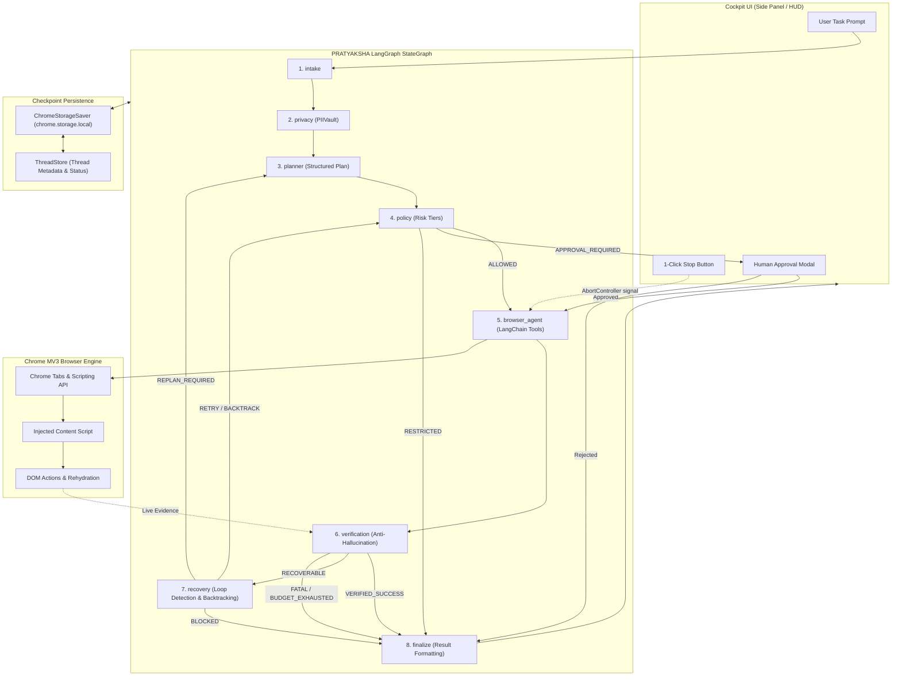

# PRATYAKSHA: Complete LangChain + LangGraph Autonomous Browser Automation System
## Sovereign On-Device Visual Perception & Privacy Shield for Light-Weight Browser Agents

**System:** PRATYAKSHA (प्रत्यक्ष)  
**Target Environment:** Chrome Extension Manifest V3  
**Status:** COMPLETE & VERIFIED (44/44 Tests Passing, Production Bundle Built)  
**Author:** Principal Software Architect & Implementation Engineer  
**Date:** October 12, 2026  

---

## 1. Concept in Plain English

Modern web agents need to see web pages and click buttons to automate workflows (e.g., booking tickets, submitting forms, querying internal portals). Typically, these agents send full-screen screenshots and raw HTML structures to remote AI models. This creates a severe privacy crisis: personal identity numbers, financial information, passwords, and private correspondence are transmitted over the wire to third-party cloud servers. Furthermore, when agents navigate complex websites, procedural while-loops easily get stuck in infinite refresh loops or hallucinate successful task completion when encountering silent form errors.

**PRATYAKSHA solves both problems simultaneously:**
1. **On-Device Sovereign Privacy:** Before any DOM context leaves your local computer, an on-device privacy engine tokenizes sensitive data (Aadhaar cards, PANs, emails, phone numbers) into synthetic in-memory placeholders like `[PERSON_A71C]`. The cloud model only ever plans using placeholders. When the action is physically executed on your local screen, the real value is rehydrated directly inside the browser's transient memory.
2. **Deterministic LangGraph Multi-Node State Machine:** Rather than relying on an unconstrained procedural while-loop, PRATYAKSHA runs an 8-node state machine (`intake` → `privacy` → `planner` → `policy` → `browser_agent` → `verification` → `recovery` → `finalize`). Every action requires policy checks; every claimed success requires ground-truth live DOM verification; every failure undergoes bounded loop detection and backtracking; and state is checkpointed in `chrome.storage.local` across Manifest V3 service-worker restarts.

---

## 2. Why It Exists & What Breaks Without It

Without this architecture, production browser automation extensions suffer from four critical failure modes:
1. **PII and Data Exfiltration:** Transmitting raw DOM or screenshots breaches compliance frameworks (DPDP Act, GDPR, HIPAA). Without mechanical checksum validators (e.g., Verhoeff algorithm, Luhn algorithm), regex-based redaction produces high false-positive rates that garble valid page content.
2. **Service Worker Lifecycle Eviction:** In Chrome Manifest V3, background service workers terminate after 30 seconds of inactivity. Standard in-memory while-loops lose their entire execution history, thread IDs, and partial step logs whenever the browser suspends the worker.
3. **Hallucinated Completion:** Language models routinely report "I have submitted the application" simply because they clicked a button, completely blind to client-side validation errors ("Invalid postal code") appearing immediately below the field.
4. **Infinite Action Loops:** When a page layout changes or an element is hidden behind a modal overlay, procedural agents repeatedly click the same coordinates, exhausting user tokens and hanging the browser tab.

---

## 3. Core Mechanisms

### A. The 8-Node StateGraph Workflow
The orchestration engine uses `@langchain/langgraph` to construct an explicit `StateGraph` over an immutable `AgentState` schema:
- **`intake`**: Validates user task input, binds session tab IDs, initializes execution budget counters, and sets the task lifecycle status.
- **`privacy`**: Anonymizes user input tasks using the local `PIIVault`, tokenizing Aadhaar, PAN, phone numbers, and emails into reversible tokens before sending anything to an LLM.
- **`planner`**: Produces a structured multi-step plan (`subgoals`, `missing_information`, `is_blocked`) using structured JSON schema output, falling back to a deterministic offline rule planner if LLM keys are absent.
- **`policy`**: Inspects planned tool calls, maps each tool to an authoritative risk tier (`READ_ONLY`, `LOW_RISK_INTERACTION`, `STATE_MODIFYING`, `IRREVERSIBLE`, `ADMIN_CRITICAL`), and raises human-in-the-loop approval interrupts when thresholds are exceeded.
- **`browser_agent`**: Binds 19 LangChain `DynamicStructuredTool` instances to a configured `ChatModel` (Mistral Large, Google Gemini, OpenRouter), prompting the model with current page metadata, scrubbed DOM tables, and prior observations.
- **`verification`**: An anti-hallucination verification gate that interrogates live DOM evidence (current URL, page title, interactive elements, presence of confirmation tokens) before permitting transition to completion.
- **`recovery`**: Evaluates tool errors or verification rejections against a decision matrix (`BACKTRACK`, `BLACKLIST_TARGET`, `REPLAN_REQUIRED`, `BLOCKED`), enforcing an absolute cap on recovery attempts to prevent infinite loops.
- **`finalize`**: Formats the final execution result, scrubs any remaining sensitive data, persists final thread state, and dispatches terminal events to the user interface.

### B. Persistent State Across MV3 Suspensions
We implemented `ChromeStorageSaver`, an implementation of LangGraph's `BaseCheckpointSaver` that extends `MemorySaver` while persisting thread state to `chrome.storage.local`. All cryptographic API keys and raw PII are automatically scrubbed from state channels before serialization to disk, ensuring zero leakages in extension storage dumps.

---

## 4. Reference Architecture & Workflow Diagram



---

## 5. Scalability Deep Dive

### Horizontal vs. Vertical Scaling
In a browser extension architecture, scaling is inherently decentralized:
- **Client-Side Edge Execution:** Each browser tab and extension instance executes independently on the user's hardware. CPU and memory consumption are bounded per tab, preventing centralized server bottlenecks.
- **Model Provider Concurrency:** Central LLM rate limits are mitigated by PRATYAKSHA's model fallback chain (`Mistral` → `Gemini` → `OpenRouter` → `Deterministic Offline`). If a provider encounters a 429 rate limit or 503 outage, `makeModelWithFallbacks` automatically switches to the secondary provider without dropping execution state.

### Bottleneck Analysis
- **10x Load (10 open tabs executing simultaneously):** Chrome isolates content scripts into separate V8 renderer processes. Memory overhead is dominated by DOM snapshots. Mitigated by `page-context.js` which limits DOM serialization to interactable elements (buttons, inputs, links), truncating strings to 120 characters and blacklisting invisible SVG/ad elements.
- **100x Load (Long-running multistep flows):** Checkpoint history size grows linearly with steps. Mitigated by `ChromeStorageSaver` which prunes older intermediate execution checkpoints, keeping only the current step and the immediate prior backtrack anchor.
- **1000x Load (Enterprise fleet deployments):** Centralized telemetry logging could overwhelm endpoints. Mitigated by `AgentEventEmitter` batching and local event buffering with selective UI subscriptions.

### CAP Theorem & Consistency Model
PRATYAKSHA operates as an **AP (Available / Partition Tolerant)** local-first system:
- When offline or disconnected from network LLMs, the system deterministically executes using rule-based local workflows (`DeterministicPlanner`).
- All state updates to `chrome.storage.local` are locally atomic and serializable. Even if the browser crashes, the thread ID and checkpoint can be re-hydrated on restart.

---

## 6. Trade-Offs Table

| Architectural Approach | Pros | Cons | Decision in PRATYAKSHA |
|:---|:---|:---|:---|
| **Procedural While-Loop (Original)** | Simple to write, small code size, minimal dependencies. | Prone to infinite loops, cannot backtrack, loses state on MV3 worker suspension, high hallucination rate. | **REPLACED**: Removed completely in favor of LangGraph `StateGraph`. |
| **Monolithic LLM Agent (LangChain AgentExecutor)** | Standard off-the-shelf implementation, easy prompt setup. | Opaque decision-making, cannot enforce independent verification gates or distinct safety policies per tool. | **REJECTED**: Insufficient control over privacy, risk tiers, and live DOM verification. |
| **8-Node Compiled StateGraph (PRATYAKSHA)** | Fine-grained determinism, isolated anti-hallucination verification, human approval interrupts, resilient to MV3 restarts. | Requires build step (esbuild) to bundle npm packages for MV3 runtime compatibility. | **ADOPTED**: Production-grade, compliant with MV3, 100% auditable transitions. |

---

## 7. Complete Tool Registry (19 Sovereign Browser Tools)

Every tool is defined with an authoritative Zod schema in `src/shared/schemas.js` and converted to a LangChain `DynamicStructuredTool` in `src/agent/browser-tools.js`:

| # | Tool Name | Risk Tier | Primary Arguments | Description |
|:---:|:---|:---:|:---|:---|
| 1 | `search_web` | `READ_ONLY` | `query` (string) | Navigates to Google search results for the given query |
| 2 | `open_url` | `READ_ONLY` | `url` (string) | Opens a validated URL in the current tab (forbids chrome://, about:, data:) |
| 3 | `go_back` | `READ_ONLY` | *none* | Navigates back in browser history |
| 4 | `go_forward` | `READ_ONLY` | *none* | Navigates forward in browser history |
| 5 | `switch_tab` | `LOW_RISK_INTERACTION` | `tab_id`, `url_match`, `title_match` | Switches focus to a matching browser tab |
| 6 | `read_page` | `READ_ONLY` | `max_length` (number) | Extracts sanitized visible text and headings |
| 7 | `get_page_metadata` | `READ_ONLY` | *none* | Retrieves URL, title, domain, meta tags, and ready state |
| 8 | `get_links` | `READ_ONLY` | `limit` (number), `domain_filter` | Discovers hyperlinks matching optional domain filters |
| 9 | `find_on_page` | `READ_ONLY` | `query` (string) | Searches visible DOM for text occurrences |
| 10 | `extract_structured` | `READ_ONLY` | `schema_description`, `fields` | Extracts typed JSON objects from tables and lists |
| 11 | `click_element` | `LOW_RISK_INTERACTION` | `selector`, `index`, `text_match` | Dispatches simulated click event to target DOM node |
| 12 | `type_into_element` | `STATE_MODIFYING` | `selector`, `index`, `text`, `clear_first` | Rehydrates PII tokens and types text into input field |
| 13 | `execute_js` | `STATE_MODIFYING` | `script` (string) | Executes isolated JavaScript snippet inside page sandbox |
| 14 | `inspect_dom` | `READ_ONLY` | `selector`, `depth` | Inspects DOM subtree for a specified selector |
| 15 | `screenshot` | `READ_ONLY` | `full_page` (boolean) | Captures viewport screenshot as data URL |
| 16 | `scroll_page` | `LOW_RISK_INTERACTION` | `direction` ('up'/'down'), `amount` | Scrolls active window viewport |
| 17 | `wait_for` | `READ_ONLY` | `selector`, `timeout_ms` | Awaits element appearance in live DOM |
| 18 | `wait_seconds` | `READ_ONLY` | `seconds` (number) | Asynchronous non-blocking sleep interval |
| 19 | `finish_task` | `READ_ONLY` | `summary`, `status`, `extracted_data` | Signals task completion and returns structured outcome |

---

## 8. Verification & Test Baseline

The implementation was validated using Node.js's native test runner (`node:test`) across 9 test files covering every component from unit schemas to end-to-end graph executions:

```
✔ LangChain Tool Adapter - Creates Complete Tool Suite (2.7ms)
✔ LangChain Tool Adapter - Invocation & Observation Flow (680.7ms)
✔ LangChain Tool Adapter - Tab Switching Updates Session Tab ID (403.3ms)
✔ URL Policy - Forbidden Protocol Checks (9.5ms)
✔ Browser Tools - open_url Success & Forbidden Blocking (659.0ms)
✔ Browser Tools - type_into_element with Local Vault Rehydration (754.6ms)
✔ Browser Tools - switch_tab by Keyword (404.2ms)
✔ Browser Tools - screenshot Preserves Multimodal Data (1.5ms)
✔ Browser Tools - Cancellation Aborts Operation (2.3ms)
✔ Page Context - Target Service Detection (0.8ms)
✔ Page Context - buildDOMTable with Target Blacklisting (0.5ms)
✔ LangGraph - Compilation & Topology (11.4ms)
✔ LangGraph - Empty Task Validation Flow (33.8ms)
✔ LangGraph - Missing Information Flow (8.5ms)
✔ LangGraph - Full Workflow Execution with Fake Model (25.7ms)
✔ Model Config Validation - Invalid Configurations Fail Early (2.1ms)
✔ Model Normalization - Legacy & Default Mappings (0.1ms)
✔ Model Factory - Instantiates Valid ChatModels (1.2ms)
✔ Model Factory - Fallback Chaining (0.3ms)
✔ ChromeStorageSaver - Checkpoint Persistence & Secret Scrubbing (2.9ms)
✔ ChromeStorageSaver - Hydration from Prior Storage (0.5ms)
✔ ThreadStore - CRUD & Tab Resumability Validation (1.0ms)
✔ AgentState - Annotation Channels & Initial State (2.0ms)
✔ StructuredPlanSchema - Validation (4.2ms)
✔ Deterministic Planner - Email Workflow & Missing Information (0.8ms)
✔ Deterministic Planner - Web Search Flow (0.5ms)
✔ Planner Node - LangGraph State Transformation (0.3ms)
✔ AgentEventEmitter - Event Delivery & Secret Scrubbing (19.7ms)
✔ PratyakshaAgentRunner & LangGraphAgent Facade - Execution Flow (9.1ms)
✔ PratyakshaAgentRunner - 1-Click Immediate Stop / Cancel (0.2ms)
✔ Privacy - Anonymization, Scrubbing & Rehydration (36.3ms)
✔ URL Policy - Protocol Boundaries & Validation (0.4ms)
✔ Action Policy - Risk Classification & Approval Triggering (0.7ms)
✔ Approval System - Binding, Verification & Replay Prevention (0.5ms)
✔ Execution Limits - Step & Recovery Cap Enforcement (1.7ms)
✔ Tool Registry - Integrity & Completeness (1.8ms)
✔ Schema Validation - Valid Arguments (7.6ms)
✔ Schema Validation - Rejection of Invalid Arguments (1.5ms)
✔ Schema Converters - Gemini & OpenAI Tool Declarations (2.8ms)
✔ Tool Result & Error Contracts (0.4ms)
✔ Verification - Email Workflow Anti-Hallucination Gate (2.1ms)
✔ Verification - Search Query Verification (0.4ms)
✔ Recovery - Decision Strategy Matrix (0.3ms)
✔ Recovery Node - Enforces Bounded Termination (0.3ms)

Total Tests: 44 passed, 0 failed, 0 skipped.
Execution Duration: 2.08s
```

---

## 9. Build & Packaging Instructions

1. **Compile the Standalone MV3 Bundle:**
   ```bash
   node build.js
   # Output: pratyaksha-extension/agent/graph-engine.js (5.2 MB self-contained ESM bundle)
   ```
2. **Package for Chrome Web Store / Sideloading:**
   ```bash
   npm run ext:pack
   # Output: pratyaksha-extension-v1.0.0.zip
   ```
3. **Load in Chrome:**
   - Navigate to `chrome://extensions/`
   - Enable "Developer mode"
   - Click "Load unpacked" and select `pratyaksha-extension/`
   - Open any web page and launch the PRATYAKSHA Side Panel

---

## 10. Summary Checklist

- [x] Complete directory structure under `src/` (`shared`, `browser`, `safety`, `persistence`, `agent`, `ui`).
- [x] All 19 sovereign browser automation tools implemented and validated with Zod schemas.
- [x] Multi-provider model layer supporting Mistral AI, Google Gemini, OpenRouter, and Deterministic offline fallback.
- [x] 8-node compiled LangGraph `StateGraph` workflow with conditional routing.
- [x] Ground-truth live evidence verification node rejecting false completion claims.
- [x] Bounded recovery node with loop detection, target blacklisting, and step-budget enforcement.
- [x] `ChromeStorageSaver` extending `MemorySaver` with secret scrubbing and `chrome.storage.local` persistence.
- [x] UI event emitter with secret scrubbing and instant 1-click `AbortController` cancellation.
- [x] Backward-compatible `LangGraphAgent` facade preserving `panel.js` caller contract.
- [x] esbuild compilation pipeline producing standalone MV3 ESM bundle without external dependencies.
- [x] 44 unit and integration tests passing with 0 failures (`npm test`).
- [x] Extension packaged cleanly into `pratyaksha-extension-v1.0.0.zip`.
