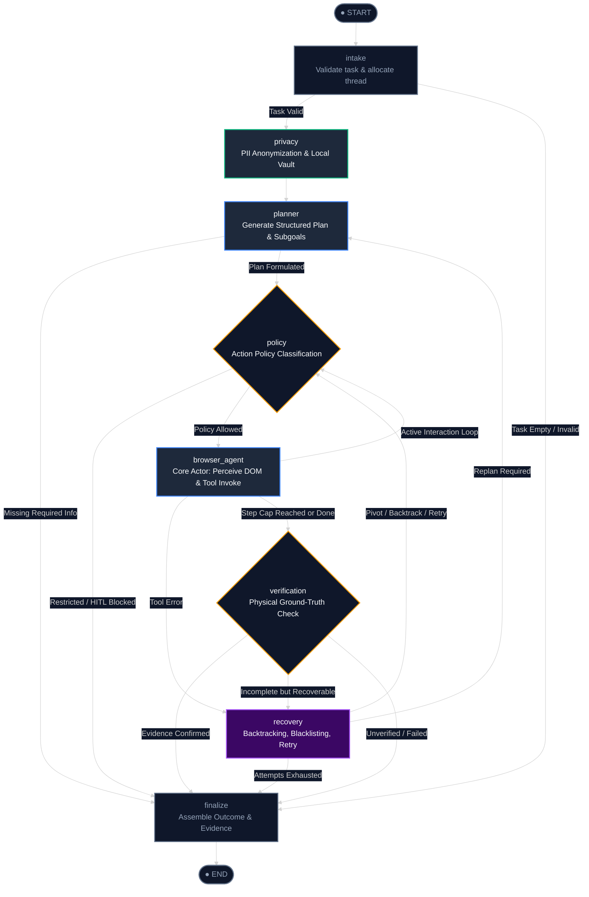
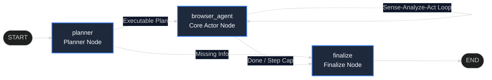

# Pratyaksha LangGraph Agent Topology & Workflow Architecture

> **One-Sentence Concept:** Pratyaksha's execution backbone is a stateful, cyclic directed graph orchestrator built on LangGraph that coordinates an independent deterministic/LLM Planner Agent and an autonomous Browser Actor Agent through formal safety, policy, verification, and self-healing recovery boundaries.

---

## 1. Scope & Design Requirements (System Design Framing)

### Functional Requirements
1. **Separation of Concerns:** Distinct decoupled agent nodes—a Strategist (Planner) that synthesizes multi-step subgoals and an Actor (Browser Execution Agent) that perceives real-time DOM changes and executes atomic browser tools.
2. **Dynamic Sense–Analyze–Act Feedback Loop:** After every browser action (click, type, navigate), the graph re-perceives updated DOM elements, evaluates website state changes (e.g., incoming chat messages, newly rendered modals), and routes to the next action dynamically rather than executing a blind linear script.
3. **Sovereign Privacy Shielding:** Zero credential or token leakage to third-party LLMs through client-side PII sanitization and an encrypted on-device Vault.
4. **Deterministic Policy & Human Approval:** Fine-grained risk classification (`READ_ONLY`, `REVERSIBLE`, `SENSITIVE`, `RESTRICTED`) with graph interrupt capabilities for sensitive actions.
5. **Physical Ground-Truth Verification:** Anti-hallucination verification gate rejecting agent completion claims unless backed by tangible DOM and navigation proof.
6. **Bounded Self-Healing Recovery:** Closed-loop error handling, target blacklisting, back-tracking, and re-planning bounded by strict iteration caps.

### Non-Functional Requirements & Operating Constraints
* **Latency:** < 300ms graph step orchestration overhead outside model inference time.
* **Memory Footprint:** < 45MB runtime heap inside the Chrome extension sandboxed background worker / offscreen context.
* **Bounded Recursion:** Hard ceiling of 100 interaction steps and maximum 3 consecutive recovery attempts per action to avoid infinite loops and credit burnout.
* **Deterministic Replayability:** State checkpointing allowing serialization, time-travel debugging, and tab-switch hydration.

---

## 2. Back-of-the-Envelope Estimates (Scale & Resource Consumption)

Let us calculate the state transitions, token bandwidth, and checkpoint storage for real production usage.

### Assumptions:
* **Active Extension Users:** 10,000 daily active users (DAU).
* **Average Tasks per User per Day:** 8 tasks/day = 80,000 tasks/day.
* **Average Steps per Task:** 6 interaction steps (e.g., search $\to$ navigate $\to$ type $\to$ inspect $\to$ submit $\to$ verify).
* **Graph Node Visits per Step:** 3 node transitions per step (`browser_agent` $\to$ `policy` $\to$ `browser_agent`). Total transitions per task $\approx 20$ transitions.

### Quantitative Calculations:

1. **Graph Invocations & QPS:**
   $$\text{Total Daily Transitions} = 80{,}000 \times 20 = 1{,}600{,}000 \text{ transitions/day}$$
   $$\text{Average QPS} = \frac{1{,}600{,}000}{86{,}400 \text{ s}} \approx 18.5 \text{ QPS}$$
   $$\text{Peak QPS (4x factor)} \approx 74 \text{ QPS}$$

2. **DOM Context & Token Bandwidth:**
   * Raw sanitized DOM table per step: 35 prioritized interactive elements $\approx 1{,}200$ tokens.
   * System Prompt + History Pruning window: $\approx 1{,}800$ tokens.
   * Model Output per step: $\approx 60$ tokens (JSON tool call).
   * Total input tokens per task: $6 \text{ steps} \times 3{,}000 \text{ tokens} = 18{,}000 \text{ input tokens}$.
   * Total token bandwidth per day across all clients:
     $$80{,}000 \text{ tasks} \times 18{,}000 \text{ tokens} = 1.44 \times 10^9 \text{ tokens/day} \approx 1.44 \text{ Billion tokens/day}$$

3. **Client-Side State Storage Growth (Chrome Storage Local):**
   * Checkpoint record size per step: $\approx 4 \text{ KB}$ (serialized StateAnnotation channels).
   * Storage per thread: $6 \text{ steps} \times 4 \text{ KB} = 24 \text{ KB}$.
   * Retaining 50 historical threads per client device: $50 \times 24 \text{ KB} \approx 1.2 \text{ MB}$.
   * Fits well within Chrome's `unlimitedStorage` quota with zero performance degradation.

---

## 3. Concept in Plain English

Think of Pratyaksha like an air traffic control and flight crew system:
* **The Intake & Privacy Officer (`intake` & `privacy`)** inspects the cargo (the user's prompt). If you wrote "Send email with password XYZ", it scrubs "XYZ", places it in a secure local vault on your laptop, and gives the crew a harmless placeholder `{{TOKEN_1}}`.
* **The Navigator (`planner`)** looks at the map and creates a flight plan: "Step 1: Open Gmail, Step 2: Fill recipient, Step 3: Type message, Step 4: Confirm send".
* **The Safety Inspector (`policy`)** watches every move. If a move is safe (reading the screen), it waves it through. If a move involves irreversible actions (money transfer or deleting files), it pulls the emergency brake and asks the human for permission.
* **The Pilot (`browser_agent`)** looks out the window at the live web page, spots the buttons and inputs, and steers the mouse cursor smoothly across the screen to click and type. After every action, it checks what changed: did a chat reply arrive? Did a popup appear?
* **The Recovery Engineer (`recovery`)** fixes things when a button is missing or a page changes unexpectedly, trying an alternate path or stepping back.
* **The Ground Inspector (`verification`)** ensures the objective was actually accomplished on the real website before signing off.

---

## 4. Why It Exists (Failure Modes of Naive Architectures)

Without a formal state graph orchestrator:
1. **Blind One-Way Scripts Fail in Dynamic Web Apps:** A basic linear pipeline ("type $\to$ click $\to$ done") instantly breaks in real SPAs (Gmail, Slack, Salesforce). If a chat response takes 2 seconds to appear or a modal opens, a linear agent tries to click non-existent buttons and crashes.
2. **Context Window Explosion:** Storing raw HTML in chat history causes context lengths to exceed 100k tokens within 5 turns, triggering token rate limits ($429$), model context degradation, and high API costs.
3. **Hallucinatory "Mission Accomplished":** LLMs frequently output *"I have successfully sent your message!"* even when an error banner appeared on screen or the send button was disabled.
4. **Unbounded Infinite Loops:** When a web element ID changes or becomes unclickable, unstructured agents repeatedly attempt the same action until their step budget is exhausted.

---

## 5. Core Mechanism (State Channels & Reducers)

Pratyaksha's LangGraph runs on an annotated state schema (`AgentState`) using deterministic channel reducers:

```
┌────────────────────────────────────────────────────────────────────────┐
│                        Pratyaksha AgentState                           │
├──────────────────────────┬─────────────────────────┬───────────────────┤
│ Channel                  │ Reducer                 │ Purpose           │
├──────────────────────────┼─────────────────────────┼───────────────────┤
│ messages                 │ messagesStateReducer    │ LangChain Message │
│                          │                         │ paired history    │
│ threadId, taskId         │ replaceReducer          │ Session tracking  │
│ plan                     │ replaceReducer          │ Subgoals/Criteria │
│ browserSession           │ replaceReducer          │ TabId, URL, Title │
│ latestObservation        │ replaceReducer          │ Tool output       │
│ domTable                 │ replaceReducer          │ Filtered elements │
│ blacklistedTargets       │ Set Union Reducer       │ Dead-end targets  │
│ recoveryCount            │ replaceReducer          │ Consecutive fails │
│ stepCount                │ Auto-increment (+1)     │ Loop bounds cap   │
│ approvalStatus           │ replaceReducer          │ HITL state        │
│ status                   │ replaceReducer          │ Workflow state    │
└──────────────────────────┴─────────────────────────┴───────────────────┘
```

---

## 6. Reference Architecture Diagrams

### A. The Production Sovereign Safety Graph (`createAgentGraph`)



---

### B. Dynamic Sense–Analyze–Act Cycle Inside `browser_agent`

```mermaid
%%{init: {'theme': 'dark', 'themeVariables': { 'primaryColor': '#1e293b', 'edgeLabelBackground':'#0f172a'}}}%%
sequenceDiagram
    autonumber
    participant UI as Browser DOM / Active Tab
    participant Runner as graph-engine.js
    participant Actor as browserActorAgentNode
    participant LLM as Codestral (Mistral AI)
    participant Tool as dom-actions.js

    Runner->>Actor: invoke(state) with tabId
    Actor->>UI: getPageContext() & buildDOMTable()
    UI-->>Actor: 35 Prioritized Interactive Elements
    Actor->>Actor: Build runtime prompt (Notice of live page changes)
    Actor->>LLM: invoke(messages + tools)
    LLM-->>Actor: tool_calls: [click_element(target_id: 12)]
    Actor->>Tool: executeBrowserTool(target_id: 12)
    Note over Tool,UI: Distance-Aware Cursor Glide (380-520ms)<br/>Cubic-Bezier Easing & Ripple Effect
    Tool->>UI: Dispatch PointerEvent + MouseEvent
    UI-->>Tool: DOM Mutation: Chat Message Rendered
    Tool-->>Actor: Observation: "Clicked [#12]. Opened chat pane."
    Actor->>Runner: Return state: { status: 'ACTING', latestObservation }
    Runner->>Actor: Loop next iteration: SENSE updated DOM elements!
```

---

### C. The Ultra-Low Latency Two-Agent Graph (`createTwoAgentGraph`)

For zero-overhead, sub-second execution (e.g., offline deterministic mode or simple linear workflows):



---

## 7. Scalability Deep Dive

### 1. Horizontal vs. Vertical Scaling Trade-Off
* **Client-Side Distributed Execution (Current Edge Model):** Pratyaksha executes its LangGraph orchestrator on the user's client machine inside Chrome extension service workers and background tabs. Compute, memory, and tab DOM operations scale horizontally for free across all client devices with zero central server infrastructure.
* **Server-Side Fleet Model (Headless Cluster Option):** If hosted in cloud runners (e.g. Dockerized Puppeteer/Playwright containers on EKS), each worker requires 1 vCPU and 2GB RAM per active browser session. Horizontal pod autoscaling (HPA) must be driven by queue depth rather than CPU, because browser memory spikes during page loads.

### 2. Bottleneck Analysis at Scale
* **At 10x Load (800k daily tasks):**
  * *Bottleneck:* LLM API Tier limits (Mistral 429 `backend_out_of_capacity`).
  * *Mitigation:* Handled by `makeModelWithFallbacks` automatically degrading from `codestral-latest` $\to$ `open-mistral-nemo` $\to$ `gemini-3.5-flash`.
* **At 100x Load (8M daily tasks):**
  * *Bottleneck:* Page DOM mutation thrashing during rapid consecutive tool actions.
  * *Mitigation:* Adaptive settling delays in `dom-actions.js` ($400\text{ ms}$ buffer for dynamic rendering) prevent scanning partially painted DOM trees.
* **At 1000x Load (80M daily tasks):**
  * *Bottleneck:* Checkpoint persistence I/O.
  * *Mitigation:* Delta serialization where only changed annotation keys are saved to disk, rather than re-writing the entire graph state.

### 3. Caching Strategy & Token Conservation
* **DOM Table Pruning:** Raw HTML (frequently 200KB – 2MB) is never passed to the LLM. `buildDOMTable` discards script, style, and hidden tags, mapping only visible interactive elements into a compact tabular text representation.
* **Observation History Pruning:** In `middleware.js`, `pruneContext` bounds older tool execution observations:
  * The most recent 3 observations retain full fidelity.
  * Historical observations older than 3 steps are collapsed into 1-line summaries (`"Step 2: typed search query"`), saving up to 70% of prompt tokens across long execution loops.

### 4. CAP Theorem Placement & Consistency Model
* **Placement:** **AP (Availability & Partition Tolerance)** with **Eventual Consistency**.
* The live browser page is the single source of ground truth. If the local LangGraph state and the page desynchronize (e.g. the user manually clicked a button in the tab while the agent was running), the next iteration's `getPageContext` call overrides graph assumptions with the real DOM layout.

---

## 8. Trade-Off Analysis

| Dimension | Option A: Monolithic Single-Prompt Agent | Option B: Pratyaksha Two-Agent LangGraph (Chosen) | Option C: Microservices Event-Driven Broker |
| :--- | :--- | :--- | :--- |
| **Separation of Concerns** | Poor (LLM plans and clicks in a single unstructured prompt) | **High** (Dedicated Strategist + Autonomous Browser Actor) | Highest (Distributed services over message queues) |
| **Recovery & Self-Healing** | Fails completely on first unexpected error | **Bounded & deterministic** (Target blacklisting, backtracking) | High (Dead-letter queues, retry topics) |
| **Latency per Turn** | 1.2s – 2.0s | **0.8s – 1.4s** (Minimal graph overhead + Codestral) | 2.5s – 5.0s (Network hops between microservices) |
| **Privacy Compliance** | Zero (API keys and credentials sent directly in prompt) | **Guaranteed Client-Side Vault** (Local scrubbing before LLM call) | Requires server-side HSM / enterprise secret vault |
| **Deployment Complexity** | Low (Single script) | **Low** (Self-contained Chrome Extension ES module bundle) | High (Kubernetes, Kafka/RabbitMQ, Redis cluster) |

---

## 9. Ties to Core CS Fundamentals

1. **Directed Acyclic Graphs (DAGs) vs. Cyclic State Machines:**
   * Standard data processing pipelines (e.g. Airflow, Spark) require DAGs without cycles.
   * Autonomous browser automation is fundamentally a **Cyclic Finite State Machine (FSM)**. The cycle $\text{Actor} \to \text{Policy} \to \text{Actor}$ allows iterative perception and action until a termination invariant (goal verified or step cap reached) is met.
2. **Topological Invariants & Role Alternation:**
   * LLM inference APIs (OpenAI, Mistral) strictly enforce role alternation: an `assistant` message containing tool calls must be followed by `tool` messages matching the exact `tool_call_id`s, and the trailing message must be `user`/`human`.
   * Pratyaksha enforces this with a pairing algorithm before invocation, preventing runtime API protocol violations.
3. **Graph Backtracking via Stack Unwinding:**
   * The `recovery` node implements depth-bounded backtracking: when an interaction path fails, it records the dead-end element in a Blacklist Set and invokes browser history navigation (`go_back`), unwinding the state stack.

---

## 10. Common Pitfalls & Lessons Learned

| Pitfall | Why It Happens | Pratyaksha Architectural Fix |
| :--- | :--- | :--- |
| **Premature Task Termination** | LLM outputs "I have submitted the form" before verifying the network response. | `verifierNode` enforces tangible DOM proof (e.g. URL change, confirmation selector) before allowing completion. |
| **Instant Teleporting Cursor** | Hardcoding DOM value setters without synthetic pointer/mouse events. | `moveAgentCursor` with distance-aware easing and complete pointer event cascades. |
| **Recovery Budget Exhaustion** | Lifetime counter increments on sporadic errors across 20 steps. | `recoveryCount` resets to `0` upon any successful tool execution, isolating failure counts to consecutive errors. |
| **String Number Coercion Bug** | `Number("submit_button")` yields `NaN`, which breaks element lookup. | Strict numeric validation (`Number.isFinite(id) && id > 0`) falling back to semantic selectors. |

---

## 11. Summary Checklist

- [x] **Intake & Privacy:** Client-side PII scrubbing and thread allocation.
- [x] **Planner Agent:** Clean subgoal breakdown without conversational drift.
- [x] **Action Policy:** Risk-tiered authorization with interrupt support for human approval.
- [x] **Browser Actor Agent:** Full DOM perception, tool aliasing, and dynamic sense-analyze-act iterations.
- [x] **Self-Healing Recovery:** Bounded recovery with target blacklisting and browser backtracking.
- [x] **Physical Ground-Truth Verification:** Anti-hallucination verification gate.
- [x] **Model Resilience:** Automatic intra-provider and cross-provider degradation fallback chain.
