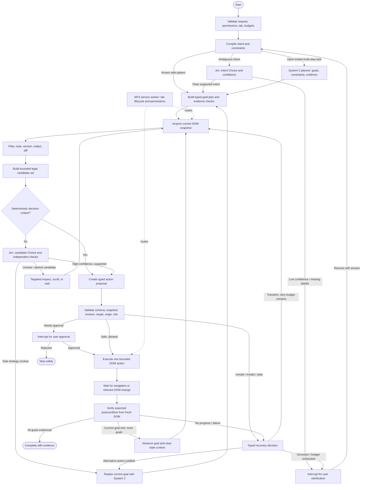

# Production Architecture Review: DOM-First Browser Agent

## Problem and scope

The project needs a reliable browser agent that acts on web pages through the DOM, keeps common decisions local and deterministic, and uses language-model reasoning only when the task cannot be handled safely by explicit rules. The immediate scope excludes screenshot/VLM/OCR/vision inference.

“Jev” means TypeSafe AI’s System One decision model. Its official docs describe typed Choice, Score, and Noul answers, probabilities/confidence for relevant answer types, and multiple independent questions evaluated against one state in a single call. It is designed for focused judgments composed by ordinary code, not long-form planning or text generation. [TypeSafe introduction](https://docs.typesafe.ai/introduction) · [Primitives](https://docs.typesafe.ai/primitives)

### Requirements to lock before implementation

- **Functional:** understand a task, inspect the active page, select a target, act, observe the result, recover from failure, and report completion based on evidence.
- **Non-functional:** low median and tail latency; no stale-target actions; bounded retries and task time; clear cancellation; minimal permissions and data exposure; reproducible task traces.
- **Initial workload:** the aspiration is general-purpose browser tasks. That is a product direction, not a claim that one model or graph can perfectly handle every website. Establish task families and success criteria, then expand coverage by measured capability.
- **Initial scale:** a browser extension runs one or a few interactive tasks per user, so local DOM extraction and action dispatch—not distributed service scaling—are the first bottlenecks. At product scale, measure aggregate opt-in telemetry and provider traffic without uploading raw page contents.

## What exists today

The repository is primarily a static documentation/demo site plus a Chrome MV3 extension. The runtime is vanilla JavaScript modules; there is no package workspace, build pipeline, shared schema package, or automated test suite visible in the tracked project structure.

The extension currently has these main responsibilities:

- `sidepanel/panel.js` owns most user interaction and constructs the autonomous agent directly.
- `agent/graph-engine.js` contains a large handwritten observe/reason/act loop, provider calls, recovery rules, and task-specific completion checks. Despite the name, it does not import or use LangGraph.
- `agent/planner.js` contains a second, separate deterministic/Gemini planning path used by step-by-step mode.
- `agent/browser-tools.js` mixes tool schemas, provider formats, browser APIs, navigation, DOM dispatch, and output formatting.
- `content/dom-actions.js` does both DOM extraction and execution. `content/content-main.js` routes messages into those functions.
- `background/service-worker.js` handles a small amount of install setup, tab events, and content-script injection.
- `vault/pii-vault.js` holds local token mappings in memory, but sanitization is not a complete egress boundary for all page-derived observations.

The README and architecture pages describe OCR, YOLO, BERT, WebGPU, offscreen documents, a privacy gateway, and other services. Those components are not in the extension runtime tree. The docs should be labeled as roadmap/proposal or updated to match what is implemented; otherwise users and contributors cannot tell which architecture is real.

The current working tree has substantial pre-existing edits. This review treats them as user work and does not alter or revert them.

## Main architectural problems

| Finding | Why it hurts production quality | Direction |
|---|---|---|
| Two agent modes have different planners and settings paths | Behavior, privacy, and bugs differ depending on a UI toggle | One task runtime and one planner interface; approval mode changes execution policy only |
| “LangGraph” is a monolithic handwritten loop | State transitions and retry behavior are difficult to inspect or test | Use an explicit finite-state task runner; rename it unless a graph library is actually adopted |
| Hosted generative reasoning is called on every loop iteration | Dominant latency and cost; repeated prompt and DOM tokens grow with task length | Use local code for exact work, Jev for bounded judgments, and a slower planner only for multi-step ambiguity |
| DOM is rescanned every turn and returned as up to 80 elements | Redundant work and token use; broad snapshots can contain sensitive values | Bounded, task-relevant accessibility-style snapshot; incremental invalidation and local filtering |
| Numeric target IDs and CSS selectors are treated as durable | IDs can refer to the wrong element after a rescan or SPA re-render | Version each snapshot and resolve a semantic locator again immediately before acting |
| Actions are mostly trusted based on dispatch success | A click event being dispatched does not prove the requested outcome happened | Require explicit postconditions and verify them from the next DOM observation |
| `execute_js` accepts arbitrary model-authored JavaScript | It bypasses the typed tool boundary and makes behavior and security hard to constrain | Remove it from the production tool set; add narrow, typed DOM operations instead |
| Completion verification contains an email/Gmail-specific special case | Rules do not generalize and can falsely accept unrelated actions | Define task-specific postconditions and require evidence before completion |
| Recovery can continue with an empty DOM after perception errors | The agent may reason from missing/stale state and waste multiple turns | Return typed perception failures; stop or use a bounded recovery path |
| PII masking focuses on user text, not all page observations and traces | DOM text/values, logs, and model payloads can still disclose sensitive data | Make outbound data construction explicit; default local-only and redact before any optional model call |
| Credentials are handled in extension-side configuration | A packaged client cannot keep a bundled provider secret | Production either uses user-supplied BYOK with clear local storage semantics or a secured service gateway |
| `<all_urls>` permissions and broad injection increase exposure | Every visited site becomes part of the agent's reachable surface | Narrow access where possible; use user gesture / active-tab permission and request site access deliberately |

DOM event simulation also has inherent limits: page handlers may distinguish trusted user input from script-dispatched events. Treat an action as successful only when the page state confirms it, and report unsupported controls instead of repeatedly dispatching synthetic events.

The current `execute_js` path uses `new Function()` in the content script. Chrome documents a restrictive content-script CSP that prevents `eval()` and external script loading; treat this implementation as unsupported and remove it instead of designing around it. [Chrome content-script security guidance](https://developer.chrome.com/docs/extensions/develop/concepts/content-scripts)

## Recommended architecture

Use a graph-orchestrated task runtime with a strict action boundary. LangGraph can be the explicit workflow controller, but it is not the decision-making intelligence: deterministic code owns permissions and execution; Jev handles compact judgments; a generative System 2 planner handles open-ended decomposition only when needed. A single extension is easier to reason about and matches MV3 deployment constraints. Perfect general browser automation is not a realistic guarantee; broad coverage comes from safe state transitions, strong observation and verification, recovery, and an evaluation set that grows with supported tasks.



The graph has one action per cycle by default. That makes each target selection use a current page revision and gives verification a clear action to attribute. Batch only actions that are independent, low-risk, and operate on the same unchanged snapshot (for example, filling two already-visible fields); always re-observe after navigation, modal opening, submission, or any action that changes the target set.

### Core loop

1. **Compile the request and constraints.** Use code for exact parsing and known workflows; ask Jev a focused Choice/Score/Noul question for uncertain intent or task category. Do not ask Jev to plan the whole task.
2. **Build graph state and select a planning path.** Supported patterns can route directly to deterministic nodes. Open-ended tasks go to a generative System 2 planner that returns a constrained plan (goal, subgoals, expected evidence), not browser code. Jev can assess independent questions in parallel against the same state, but does not do sequential reasoning between answers.
3. **Observe and create a versioned snapshot.** Capture visible, enabled, interactive elements and concise page context. Give each element an ephemeral ID scoped to that snapshot; include role, accessible name, label, input type, enabled/visible state, and limited nearby context. Exclude raw values unless the task needs them.
4. **Select targets.** Deterministic exact label/role matching wins when unambiguous. Jev can rank a bounded candidate list or classify the action needed when rules cannot decide. Filter large candidate sets in code; never let a model invent target IDs.
5. **Validate mechanically.** Check the action schema, snapshot version, target uniqueness, visibility, enabled state, origin/tab, action allowlist, and risk policy. Reject unknown tools and stale IDs. Do not pass arbitrary JavaScript to the page.
6. **Execute one action at a time.** Resolve the target again in the content script; dispatch a narrowly scoped operation and return a typed result. A model may propose; deterministic code authorizes and executes.
7. **Wait for state change, not a fixed sleep.** Use a bounded MutationObserver/event wait with timeout and cancellation. Re-observe only when relevant DOM changes occur or the action's postcondition needs checking.
8. **Verify the postcondition.** Examples: field value matches expected content, dialog appeared, URL changed to an allowed destination, or confirmation text exists. Update graph state only with observed evidence.
9. **Recover within a budget.** Refresh snapshot, re-resolve the target, and retry only when the failure is transient and the action is safe/idempotent. Otherwise replan or stop with a clear reason. Bound total turns, per-action time, and model fallback count.

### Jev’s role and boundary

Jev fits decisions such as “which intent class?”, “which observed element best matches this label?”, “is this page asking for confirmation?”, and “does this observation satisfy the expected postcondition?”. Define finite candidates and send only the minimal DOM text needed. Typed output removes free-form response parsing, but does not guarantee the selected answer is correct; confidence and probabilities need evaluation on this browser-agent workload. TypeSafe recommends risk-dependent confidence thresholds and review/no-action paths when uncertainty is high. [TypeSafe confidence guidance](https://docs.typesafe.ai/confidence)

Jev is not a substitute for planning arbitrary tasks: its documented primitives return a choice, score, or yes/no probability, not a generated multi-step plan. Keep a generative planner (or ask the user) for goal decomposition, novel strategies, and language generation. Batch independent Jev judgments in one call when they share the same state. [TypeSafe primitives](https://docs.typesafe.ai/primitives)

TypeSafe’s launch post reports 70–500 ms end-to-end latency for its service and notes results vary with its West Coast service location. Treat that as a vendor claim, not a measured latency for this extension or the user’s location. A network call still costs more than local JavaScript and introduces provider availability as a dependency. [TypeSafe launch post](https://typesafe.ai/blog/introducing-system-one-models-and-jev)

## Graph state and DOM context lifecycle

The graph state is the task record, not an ever-growing chat transcript. LangGraph’s own design guidance is to keep state structured and format model context on demand. [Thinking in LangGraph](https://docs.langchain.com/oss/javascript/langgraph/thinking-in-langgraph)

| State area | Keep | Do not accumulate |
|---|---|---|
| Task | task ID, user goal (local only), normalized goal, risk/approval policy | Repeated copies of the initial prompt |
| Plan | goal list, current goal index, completion evidence requirements | Repeated full plans after each action |
| Browser | tab ID, origin, navigation epoch, current snapshot revision | Unbounded navigation history or page HTML |
| Perception | compact page summary, current candidate records, local snapshot reference | Full DOM snapshots appended to model history |
| Decision | typed proposal, source (`rules`, `jev`, `planner`), confidence/probabilities, reason code | Free-form model thought history |
| Execution | last action, typed result, observed evidence, per-action retry counter | Repeated raw tool payloads and complete observations |
| Budget | deadline, action count, Jev calls, System 2 calls, abort signal | Implicit/infinite retries |

For each Jev call, build fresh context from **only**: the current goal, the current page’s relevant summary, a bounded candidate list, and the previous action result if needed. Do not send prior DOM tables or all prior tool results. For a System 2 plan, send the user goal plus compact task progress and evidence; do not send raw conversation turns as memory. Store verbose traces locally with PII redacted, and keep model-visible task memory bounded by explicit character/token budgets.

Use a two-tier DOM representation:

1. A local tab-scoped snapshot index stores visible interactive candidates with role, accessible name/label, type, enabled/visible state, stable locator hints, and a local element reference. Keep values out unless the current task needs them.
2. The reasoning context contains only the top relevant candidates for the current subgoal, plus a small page summary. If no candidate is convincing, inspect a specific region or scroll and take a new snapshot instead of sending a larger whole-page dump.

Increment a snapshot revision on navigation and relevant DOM changes. A `MutationObserver` should coalesce bursts and mark changed regions; avoid rescanning the entire page for every keystroke. Filter out the extension’s own overlay mutations. Crucially, do not tag page elements with `data-pratyaksha-id`: the current extractor mutates the page DOM to assign IDs, which can trigger observers and page code. Keep IDs in a content-script-side map scoped to `(tabId, navigationEpoch, snapshotRevision)`. Before acting, resolve the semantic locator again and verify it is unique, visible, enabled, and still in the expected origin.

When the side panel closes or the MV3 worker restarts, resume only from a minimal session checkpoint. Do not persist raw DOM, input values, or the PII vault. Human approval can use a LangGraph interrupt/checkpointer, but the checkpoint should contain sanitized task state and a reference to reacquire the current page snapshot, not the page snapshot itself. [LangGraph workflow design](https://docs.langchain.com/oss/javascript/langgraph/thinking-in-langgraph)

## Latency design and budgets

The cost of a task is driven mainly by serialized waits and remote round trips:

`T_task = T_compile + Σ(T_observe + T_decide + T_act + T_verify)`

The current engine sends the full accumulated `state.messages` on each reasoning call and rebuilds a system prompt with up to 75 current DOM rows. That makes context and request cost grow with turns. It also has fixed sleeps around perception/actions and provider retries. The new graph should use an explicit bounded state and change-driven waits.

| Path | Decision work | Latency strategy |
|---|---|---|
| Exact known action | Local parse + deterministic target match | No Jev call |
| Semantic ambiguity on current page | One Jev request with a bounded candidate set and independent checks batched | At most one serialized Jev call for this observation |
| Open-ended task strategy | One System 2 plan for the task or current goal | Do not call it again after each low-level action; replan only when progress evidence invalidates the plan |
| Page settling | DOM/navigation events plus bounded timeout | Replace fixed 350–1000 ms sleeps with condition waits |
| Target verification | Deterministic DOM postcondition where possible | No model call for exact checks; Jev only for semantic evidence |

For the first release, measure p50/p95 by stage and set provisional SLOs from the actual network region and representative sites. Suggested initial goals to validate—not claims about current performance—are: local compile/rank under 50 ms after snapshot availability; Jev-assisted choice under 800 ms p95; no more than one Jev round trip per unchanged observation; and a separate page-load budget for navigations. The key latency goal is to avoid serial model calls and redundant DOM scans, even when a single call is fast.

Add deadlines and cancellation to every network call and wait. On Jev timeout, rate limit, or outage, try deterministic matching if unambiguous; otherwise ask for clarification or stop. Do not silently fall through into unbounded retries or use a stale action. Limit System 2 planning calls per task and make replan decisions depend on verified lack of progress.

## Runtime boundaries and folder structure

Keep the extension deployable as one artifact, but organize by stable responsibility and import direction. Avoid importing browser APIs into the planner or putting task logic in the content script.

```text
pratyaksha-extension/
  manifest.json
  background/
    service-worker.js       # permissions, tab lifecycle, message routing only
  sidepanel/
    panel.html
    panel.js                # presentation; calls task runtime API
  runtime/
    browser-agent-graph.js  # StateGraph definition, route edges, interrupts
    task-state.js           # typed graph state and transition rules
    nodes/
      initialize.js
      compile-task.js
      plan-goals.js
      observe-page.js
      build-candidates.js
      decide-next-action.js
      validate-action.js
      execute-action.js
      verify-progress.js
      recover.js
    policy.js               # confidence, risk, approval, origin constraints
    verifier.js             # postconditions and completion evidence
    budgets.js              # deadlines, retry and model-call limits
  perception/
    dom-snapshot.js         # bounded semantic snapshot schema
    candidate-ranker.js     # deterministic target scoring
    snapshot-cache.js       # versioning and mutation invalidation
  actions/
    action-schema.js        # one canonical typed action vocabulary
    action-validator.js     # allowlist and precondition validation
    browser-tools.js        # browser-level navigation/tab tools
    dom-client.js           # typed messages to content script
  reasoning/
    adapter.js              # optional provider interface, isolated
    prompt-builder.js        # sends minimum necessary context
    response-parser.js      # strict parse; never executes raw response
  content/
    content-main.js         # message boundary and request validation
    dom-reader.js           # DOM snapshot only
    dom-actuator.js         # typed click/type/select/scroll operations
    wait-for-change.js      # mutation-based wait with abort/timeout
  privacy/
    pii-vault.js            # task-scoped ephemeral mappings
    egress-policy.js        # sole optional model-data gate
  observability/
    trace.js                # redacted structured events
    metrics.js              # latency, recovery, outcome counters
  shared/
    protocol.js             # versioned message and result schemas
    errors.js
    schemas.js              # schemas shared across graph, tools, and messages
```

The side panel should own the live task while open, or persist only the minimum resumable state in `chrome.storage.session`. The service worker can be terminated and restarted, so it should not be the authoritative in-memory task owner. Content scripts are page-scoped adapters and should not make provider calls or hold long-lived task state.

## Latency and scale

For one task with `n` reasoning turns, current wall time is approximately:

`T ≈ n × (DOM scan + provider round trip + action + fixed sleeps)`

The provider round trip is likely the largest term, while fixed sleeps and full repeated snapshots are avoidable. A DOM-first system should aim for a local action path that completes without a provider call when the intent and target are unambiguous. Measure actual p50/p95 before setting numeric goals; the repository has no valid runtime benchmarks to support the documentation's latency claims.

Track, per task and per action: snapshot duration/size, local-plan hit rate, provider calls, provider latency, action dispatch latency, time-to-postcondition, stale-target rate, retries, unsupported-control rate, completion rate, and user correction/approval rate. Store traces locally and redact text/value fields by default.

At 10× active users, provider concurrency/cost and extension update quality are likely to matter before the local DOM scan. At 100×, an optional reasoning gateway needs rate limits, timeouts, quotas, and provider isolation; the extension still needs bounded per-task compute and backpressure. At 1000×, treat provider calls as an external service workload with queueing/load shedding and aggregate metrics, but keep page DOM and task values out of centralized telemetry. These are product-scale concerns, not reasons to split the current extension into microservices now.

## Alternatives and trade-offs

| Approach | Strength | Weakness | Fit now |
|---|---|---|---|
| Pure deterministic rules | Lowest latency, offline, easy to audit | Limited language coverage; brittle if rules are broad | Best for supported intents and safe fast paths |
| Generative LLM on every action turn | Flexible for varied tasks | Highest latency/cost, repeated context, privacy burden, less predictable | Avoid as default |
| Jev for typed judgments + generative planner for open-ended tasks | Fast structured routing/selection plus broader task decomposition | Two model roles, network dependency, needs workload calibration and confidence gates | Recommended hybrid |
| Workflow templates / site adapters | Very reliable on known sites and repeat tasks | Ongoing adapter maintenance; weak generality | Add for high-value domains after generic core stabilizes |

## Production implementation plan

### Phase 0 — Prove the runtime choices

- Add a minimal build spike for LangGraph.js in the MV3 side panel, with all dependencies bundled locally as required by extension packaging. The current project has no extension bundler and mostly plain modules, so dependency compatibility and artifact size need to be proven before migrating the whole agent.
- Implement a small Jev adapter against the official API using a Choice and a Noul request; time calls from the actual target region and verify timeout/rate-limit behavior. Never put a service-owned secret in the packaged extension. Choose user-supplied BYOK or a backend gateway before production rollout.
- **Exit:** graph builds into the extension, executes a deterministic two-node workflow, and returns validated Jev output without placing secrets or raw page data in logs.

### Phase 1 — Create the eval baseline

- Capture representative task fixtures and expected evidence: click a uniquely labeled control, fill a form, read a page section, handle duplicate labels, open a modal/SPA route, recover after stale target, navigate, and pause before an irreversible submit.
- Record success rate, unsafe action rate, local vs Jev decision share, per-stage p50/p95, serialized remote calls per task, snapshot size, retries, and user corrections.
- **Exit:** every fixture has a machine-checkable completion condition and a redacted trace format.

### Phase 2 — Define contracts and consolidate the runtime

- Create versioned schemas for `TaskState`, `DOMSnapshot`, `Candidate`, `ActionProposal`, `ActionResult`, `Evidence`, and `AgentError`.
- Move graph state ownership to the side-panel runtime. Keep the service worker focused on tab lifecycle/permissions and content scripts focused on DOM I/O.
- Route autonomous and approval modes through the same graph. Approval mode inserts an interrupt before the selected action class; it must not use a second planner.
- Remove Gmail-specific completion branches and keep task-specific behavior in goal plans/evidence predicates.
- **Exit:** both UI modes follow the same state transitions and emit the same typed trace events.

### Phase 3 — Replace DOM extraction and context construction

- Stop writing `data-pratyaksha-id` attributes into the page. Build content-script-local element handles and snapshot-scoped semantic locators.
- Add navigation epochs, mutation batching, visibility/disabled checks, candidate ranking, relevance caps, value redaction, and targeted inspection.
- Build provider context per request from current task + subgoal + compact current observation + last outcome. Never append the full DOM table or raw tool history to a growing message list.
- **Exit:** after repeated SPA mutations, a target either resolves uniquely against the current snapshot or is rejected as stale; snapshot size remains bounded as task turns grow.

### Phase 4 — Implement the graph and decision policy

- Add the graph nodes/edges shown above, with explicit stop/clarify/replan/recover branches, cancellation and task budgets.
- Run deterministic code first for exact intents and unique targets. Batch independent Jev questions for one unchanged observation; include `none/inspect more` options. Route low-confidence answers to inspection or user clarification, with thresholds varying by risk.
- Call System 2 planning only for open-ended decomposition or when evidence shows the current plan is blocked. It returns typed goals and evidence requirements; it never dispatches tools directly.
- **Exit:** common tasks complete without a System 2 call; ambiguous tasks use no more than one serialized Jev round trip per unchanged observation; low confidence cannot trigger a side effect.

### Phase 5 — Harden execution, verification, and recovery

- Remove arbitrary `execute_js`; permit only schema-validated actions and bounded read operations. Validate target revision, active tab/origin, allowed destination, current enabled/visible state, and action risk immediately before dispatch.
- Replace fixed sleeps with navigation/DOM condition waits, deadlines, and abort propagation. Verify each action using its declared postcondition, not message delivery or synthetic event dispatch success.
- Require approval for consequential actions such as send, purchase, delete, publish, or submit. Do not infer that user confirmation is unnecessary from Jev confidence alone.
- **Exit:** timeout, stale target, navigation, rate limit, cancellation, and repeated no-progress all route to bounded recovery or a clear stop; no path silently reports success without evidence.

### Phase 6 — Expand general-purpose coverage by evaluation

- Add task families incrementally (forms, research, navigation, multi-page workflows, authenticated sites) and build task/site adapters only where evaluations show repeatable wins.
- Tune local rules, candidate context, Jev questions, confidence thresholds, and System 2 planning based on failure clusters, not anecdotes.
- Consider durable graph checkpoints only if the product needs resume-after-close. Persist sanitized task metadata; reacquire DOM state on resume.
- **Exit:** publish measured task-family success/latency/error rates and known unsupported cases. Do not claim “perfect” or general browser coverage without broad evidence.

## Decisions and open questions

- “Jev” is confirmed as TypeSafe AI’s System One model. Integrate it behind a model adapter and evaluate it on actual DOM-agent decisions before relying on confidence thresholds.
- The desired scope is general-purpose tasks. Keep a broad planner path, but measure quality by task family; no architecture can guarantee perfect execution across arbitrary websites.
- No latency target or supported-site scope is present. Establish these with a task benchmark rather than treating vendor claims or current-doc claims as project measurements.
- DOM-only is a sensible first production boundary. It will not handle canvas-only controls, inaccessible embedded documents, or pages that deliberately block scripted interaction; the agent should clearly report these limitations and stop safely.

## Checklist

- [ ] One runtime, one canonical action schema, one source of policy.
- [ ] Deterministic local fast path before any remote reasoning.
- [ ] Snapshot-scoped targets resolved again at execution time.
- [ ] Typed allowlisted actions; no arbitrary page JavaScript.
- [ ] Completion based on observed postconditions.
- [ ] Bounded retries, waits, model calls, task duration, and cancellation.
- [ ] Page data redacted and locally retained by default.
- [ ] Documentation matches implementation; benchmarks report measured values.
